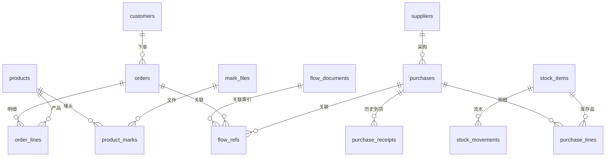

# 数据模型

有哪些表、怎么关联、哪些不能改。结构以迁移代码为准：`server/db.ts`、`server/operations/schema.ts`、`server/flow/schema.ts`、`server/finance/schema.ts`。

除特别说明，都在 `data/erp.sqlite`。

## 关系总览

## 业务表

| 表 | 内容 | 注意 |
|---|---|---|
| `customers`、`suppliers`、`products` | 档案 | 带 `version`；扩展字段在 `product_extensions` |
| `orders`、`order_lines` | 客户订单 | 产品名、规格、客户名是快照，改档案不影响历史。扩展字段在 `order_extensions`、`order_line_extensions` |
| `purchases`、`purchase_lines` | 采购单 | `received_units` 是派生缓存，不是事实来源 |
| `purchase_receipts` | 到货记录 | 含旧独立收货和正式到货的投影，通过 `flowId` 去重 |
| `stock_items` | 原料和成品档案 | 数量单位独立，不换算 |
| `stock_movements` | 库存流水 | **库存唯一事实来源**，只追加；数量为千分单位整数 |
| `stock_movement_revisions` | 管理员改写流水的记录 | 改写流水必须写这里 |
| `flow_documents` | 到货、任务、完工、送货单 | 明细在 `document` JSON，类型见 `shared/physical-flow.ts` |
| `flow_refs` | 单据关联索引 | **写送货、任务单时必须维护** |
| `flow_previews`、`flow_receipt_keys`、`flow_file_uses`、`flow_sources` | 确认预览、送货单号防重、原件 | |
| `product_marks`、`mark_files` | 产品唛头 | 同一文件只存一份，每款记页码 |
| `inbox_items`、`inbox_files` | 收件箱 | 同来源同消息只记一条；相同文件只存一份 |

## 系统表

| 表 | 内容 |
|---|---|
| `schema_migrations` | 已执行的迁移 |
| `business_audit` | 业务审计，只追加 |
| `record_lifecycle` | 归档状态（客户、产品、订单等） |
| `permanent_delete_previews`、`permanent_record_deletions` | 永久删除的预览和记录 |
| `operation_requests` | 幂等记录；单据模板、导出文件和交付回执也存在这里（用 `kind` 区分） |
| `import_previews`、`import_executions` | 正式导入的预览和执行台账 |
| `assistant_threads`、`assistant_messages`、`assistant_runs`、`assistant_previews`、`assistant_audit` | 助手聊天、任务、审计（按账号隔离） |
| `assistant_attachments`、`assistant_message_attachments` | 聊天附件 |

## 财务表

财务表在同一 SQLite 业务库。迁移 16 建基础表，迁移 17 保留原记录并扩展业务表。财务分录、往来和业务事件存身份及名称快照，业务档案删除不会级联清除会计档案。

| 表 | 用途与主要关系 |
|---|---|
| `fin_settings`、`fin_accounts`、`fin_templates` | 单账套设置、科目树、可配置的凭证映射 |
| `fin_periods`、`fin_opening`、`fin_requests` | 开放或已结期间、期初余额和年累计、写入回执 |
| `fin_vouchers`、`fin_entries` | 凭证和分录。红字凭证引用原凭证，辅助项存 ID 和名称快照 |
| `fin_events`、`fin_source_observations` | 财务事件、来源版本、哈希及最新观察位置。资料待补保留理论货款 |
| `fin_party_terms`、`fin_obligations`、`fin_installments` | 单位账期和税率，往来单和分期。凭证、到期日可空，期初关联期初行 |
| `fin_cash_accounts`、`fin_cash_documents`、`fin_allocations` | 资金账户、收支转账单和核销。支持反向核销和现结优惠 |
| `fin_statements`、`fin_bad_debts` | 对账单状态和差异，坏账凭证记录 |
| `fin_deposits`、`fin_deposit_actions`、`fin_interest` | 保证金、部分退回转抵及经人工确认的利息 |
| `fin_mapping_profiles`、`fin_bank_rows`、`fin_bank_matches`、`fin_notes` | 文件列映射、银行流水和单笔或合并分录匹配、承兑票据 |
| `fin_invoices`、`fin_invoice_links`、`fin_attachments` | 蓝红发票、发票与往来分配、按 SHA-256 去重的原件 |
| `fin_expenses` | 员工费用单，关联审批凭证和资金付款单 |
| `fin_assets`、`fin_depreciation` | 固定资产卡片和每期折旧 |
| `fin_payroll` | 员工、部门工资数据，详情单独鉴权 |
| `fin_inventory_costs`、`fin_cost_sales` | 库存品每期成本金额、数量和原单位，销售流水的成本分配 |
| `fin_period_jobs`、`fin_report_snapshots`、`fin_budgets` | 月末任务、不可覆盖的报表快照、科目预算 |

金额以整数分存储，变更审计进 `business_audit`。完整备份包含财务表及附件字节。只有本机管理员的人工初始化可按范围清理财务，已结账范围须在预览确认。

## 其他数据库

| 文件 | 内容 |
|---|---|
| `data/security/users.sqlite` | 账号、账号审计及部署模式下的 `auth_sessions`，只保存令牌哈希、关联账号和到期时间 |
| `data/ai-imports/workspaces.sqlite` | AI 导入工作区（草稿、识别任务、错误档案），文档存 JSON |
| `data/ai-tools/tools.sqlite` | 插件和工具开关 |
| `data/ai-prompts/*.sqlite` | 各模块提示词 |
| `%LOCALAPPDATA%\ZhixuERP\ai\settings.sqlite` | 模型服务配置 |
| `%LOCALAPPDATA%\ZhixuERP\wecom\bot.sqlite` | 机器人凭据 |

部署会话可跨正常重启。临时超级管理员和开发者状态在内存中。完整备份保留账号，备份副本清除会话记录，恢复后须重新登录。

## 约定

- **金额：** `*_cents` 是分；单价精确值用字符串（最多四位小数），在扩展 JSON 里。计算用 `shared/precision.ts`。
- **并发：** 可编辑记录带 `version`，写入时校验。
- **JSON 列：** `document`、`fields` 等存结构化内容，字段规则在 `shared/`。
- **删除：** 日常是归档（`record_lifecycle`）。物理删除由 `database-maintenance` 处理关联，并写审计。
- **状态派生：** 订单发货进度、采购到货进度都由单据算出来，不存第二份事实。
