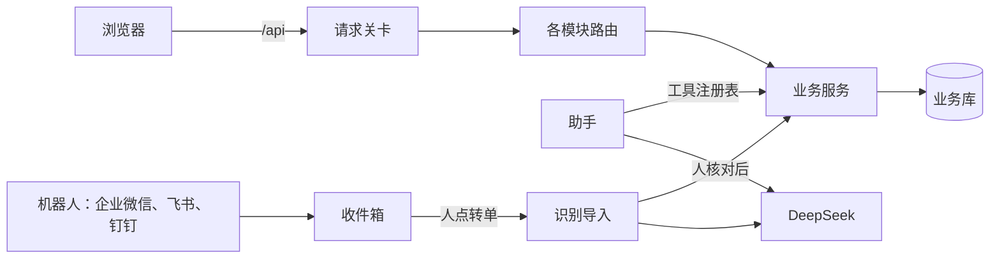

# 架构总览

什么时候读：第一次接触这个项目时读，讲系统是什么、一张订单的数据怎么走、目录放什么、一次请求怎么走。

版本号以代码为准：软件 `shared/core/version.ts`，业务库结构 `server/core/schema/version.ts` 的 `SCHEMA_LATEST`。

## 总览

- **是什么、谁用：** 宁波甬勒包装制品有限公司自用的纸箱厂 ERP。员工按账号级别登录：管理员、业务人员、只读、财务、出纳。正式部署在腾讯云 Ubuntu 服务器，同机 Caddy 做 HTTPS，域名已备案；Windows 也能单机装。
- **怎么跑：** 一个 Node 进程（`server/index.ts`）既回 `/api`，也发构建好的页面 `dist/`，只监听本机回环；部署时另开一个端口给同机 Caddy。员工用浏览器，或安卓 App（`apps/android`）、Windows 客户端（`apps/desktop`）打开同一个网址。
- **技术栈：** 前端 React 19 + Vite（哈希路由），服务端 Express 5 + `node:sqlite`，TypeScript，Node 24；前后端共用 `shared/` 的类型、校验和计算。模型只接 DeepSeek。
- **数据：** 业务数据（客户、产品、订单、采购库存、单据、财务、助手会话、审计）在一个业务库 `erp.sqlite`。账号、出错记录、AI 设置、提示词、助手工具设置、机器人设置、AI 识别工作区各是一个小配置库。原件、备份、删除前快照是文件。各库都按编号的升级步骤升级（相关的见 `docs/架构/数据库升级.md`）；有哪些表见 `docs/生成/表结构.md`。
- **三个入口进同一套服务：** 页面经请求关卡到各模块路由；助手经工具注册表调同一批业务服务，改数据一律出确认卡片；机器人只收文件进收件箱，人点了才转进识别导入。

## 一张订单的数据怎么走

括号里是负责的模块（模块怎么分相关的见 `docs/架构/模块规则.md`）。

1. **进件和接单：** 客户文件经机器人进收件箱（识别导入）。人点“转订单”复制进 AI 导入工作区（也可直接上传），点识别时原件发给 DeepSeek 填表。人核对后正式导入，一个事务里建客户、产品、订单（`server/import/import-execution.ts`）。也可在订单页手工建。订单存 `orders`、`order_lines`（客户产品订单的 `sales(store)`），手工保存入口在订单服务（`server/orders/service.ts`）。人能选的状态只有待确认、已确认、已取消。
2. **采购和到货：** 采购单（采购库存）合成订货单导出给供应商（单据导出），文件存好后采购单变已订货（也可不导出直接改）。货到了按订货单登记到货（单据流转的 `registerArrival`；AI 识别的送货单先存成待入库）。核对确认（`server/flow/rules/confirm.ts`）时写入库流水 `stock_movements`（原材料只收“张”），采购明细的已到货跟着重算。
3. **生产：** 安排生产任务（`flow_documents` 的 `task`，安排即下达）。登记完工（`production`，可先存成待入库再逐张核对），入库时写成品入库（只收“只”）和领料出库流水。订单的生产中、待发货由有效单据重算。
4. **送货：** “安排送货”出待送货的送货单（`delivery` 的 `draft`）。导出并出库（或不导出直接出库）时写成品出库流水、单据生效，订单变已发货或显示部分发货。确认送达只记日期。库存余额由流水加总，不能为负。
5. **进财务：** 财务只经单据流转的只读窗口 `financeFacts` 读业务。财务页面和助手查财务前先补扫：每张已确认或已撤销的送货、到货、完工单和盘点流水生成一条财务事件 `fin_events`。资料待补（如缺税率）或等发票的送货、到货，先按单据单价挂暂估往来 `fin_obligations`（应收、应付）。缺税率不拦业务，事后在月度台账补。
6. **记账和收款：** 财务人员处理事件、生成凭证（送货确认收入、到货暂估，同时记往来）。登记收款单、付款单（`fin_cash_documents`，保存后确认），核销到送货、到货挂的那笔应收应付（`fin_allocations`，`server/finance/cash/settlements.ts`；地址见 `docs/功能/功能链路-财务.md`）。再登记发票，月末算成本（加权平均）、结账、出报表。已记账凭证只能红字冲销；业务单据事后被更正、撤销、删除，财务下次补扫按来源指纹发现并标出要人处理的。

## 目录

| 位置 | 放什么 |
|---|---|
| `server/` 根目录 | `index.ts` 正式启动（按真实数据目录，不要运行或加载；建好各模块交给 `app.ts`）、`app.ts` 挂路由和发页面（测试和预览实例从这里起）、`http-guards.ts` 请求关卡、`http-errors.ts` 出错回答、`backup-extras.ts` 备份里另存的本机配置清单、`maintenance.ts` 维护命令行（`backup`、`restore`、`reset-password`、`revert-config-upgrades`）、`local-service.ts`、`stop.ts` |
| `server/<模块>/`、`shared/<模块>/`、`src/<模块>/` | 各模块代码，对外只走 `index.ts`（整页走 `pages.ts`）；新目录先在 `tests/checks/module-map.ts` 登记 |
| `src/` 根目录 | 入口 `main.tsx`（全部样式在这里引入、定先后）、`App.tsx`、外壳 hook `app-shell.ts`（含设置页签谁看得到 `settingsTabsOf`）、导航、插槽装配 `slots.ts`、登录页和账号菜单、安卓 App 通道 `app-bridge.ts` |
| `public/` | `theme-init.js`（首屏主题）、`favicon.svg` |
| `scripts/` | 启停、构建 `build.mjs`、测试和体检（`run-tests.mjs`、`check.mjs`、`check-apps.mjs`）、发布和补丁（`package-release.mjs`、程序文件清单 `release-files.mjs`、`patch-server.mjs`）、`schema-dump.ts`、生成 `docs/生成/` 的 `docs-gen.ts` 和 `docs-gen/`、`linux/`（服务器脚本、systemd、Caddy 示例；补丁在服务器上由 `apply-patch.mjs` 执行，回滚时先换回配置库再看业务库；它引的同目录文件要列进 `patch-server.mjs` 的 `applyScripts`）、`ui-check/`（界面实测、预览实例 `preview.mjs`、样式比对、识别前后对比） |
| `tests/` | 测试和准备代码，相关的见技能 `.claude/skills/testing/` |
| 根目录 | 检查配置 `eslint.config.js`、`stylelint.config.mjs`、`knip.json`；给 AI 的规则和环境 `AGENTS.md`、`CLAUDE.md`、`.claude/`（三家智能体共用，`.agents/` 和 `.codex/` 只放指路配置）；Windows 启停 `启动系统.cmd`、`停止系统.cmd` |
| `docs/` | 文档，清单在 `AGENTS.md` 的文档地图 |
| `apps/` | 两个应用外壳，各自成一体、不引用项目其余代码：`apps/android/`（原生 Java WebView）、`apps/desktop/`（Rust + Tauri 2）；和网页的接点相关的见 `docs/架构/外壳和网页.md` |

## 一次请求怎么走

1. **前端：** 一律经 `src/ui/http.ts` 的 `request` 发（`call()`、带 `X-ERP-AI-Token` 的 `tokenRequest`、上传 `uploadFile` 都经过它）。请求收在各模块的 `*-api.ts`，一个写地址只由一个函数发；财务读用 `useFinRead`、`finRead`，写用 `call<FinanceWrites>()`、经 `finWritten` 刷新。返回 `unknown` 的由调用方按结构认。没登录时说“请先登录账号。”、不发；只有 401 回登录页；断网说“连不上服务器，请检查网络后再试。”；服务器回正忙（429 `busy`）按 `Retry-After` 停一下自动再发一次；失败的请求和页面报错上报出错记录；事件流由 `readEventStream` 读。
2. **关卡（`server/http-guards.ts`，按顺序）：** 记失败请求 → 安全响应头 → 只许本机或登记的代理域名、核对来源、写请求只收 JSON（几个上传入口除外）→ 纯财务账号只能用财务接口（`shared/core/account-scope.ts`）→ 除 `/api/health`、`/api/auth/*` 外要登录 → 写接口要页面凭证（`/api/auth/*`、`/api/ai/*` 用各自的凭证）。
3. **路由 → 服务：** 路由只取参数；权限、版本校验、事务、防重复、审计在服务里（`docs/业务规则.md`“写入”）。接口表、读库、单据状态和种类的写法、防重复提交、事务保存点、先预览再确认、审计各只有一种做法，相关的见 `docs/架构/服务端写法.md`。
4. **出错（`server/http-errors.ts`）：** 校验没过回 400，经 `shared/core/user-errors.ts` 的 `userError` 写成按界面叫法的中文整句（按地址认记录种类，如采购单的日期叫“采购日期”；页面显示时再过一遍）。`AppError` 原样带状态码、`code`、`details`。被数据库约束拦下的回“数据没有保存：有内容不符合数据规则，请联系维护人员。”，英文原文进带 `[数据规则]` 的日志。业务代码该在写库前拦住说清原因，走到约束就是程序问题。
5. **边算边推：** 助手对话、识别、朗读、语音识别只用 `server/core/http/stream.ts`：`openEventStream`（心跳每 10 秒一行注释；同一阶段的进度和字最多 250 毫秒推一条，换阶段和最后一条不丢）、`pipeBytes`、`watchDisconnect`。
