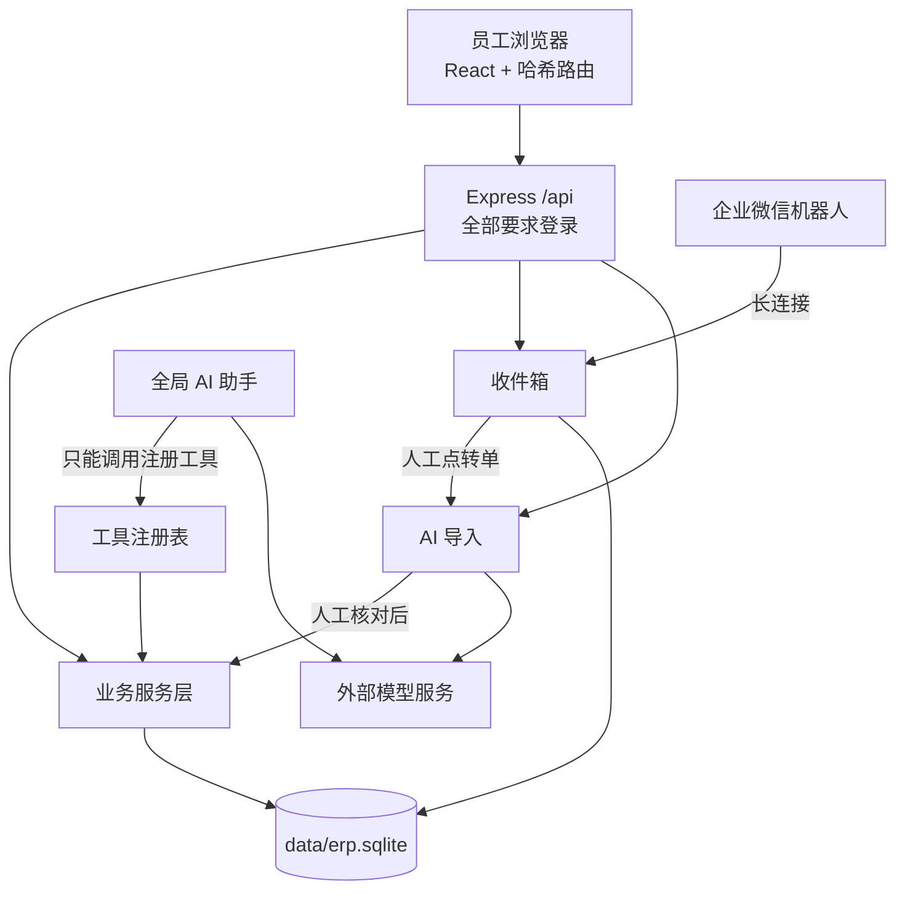
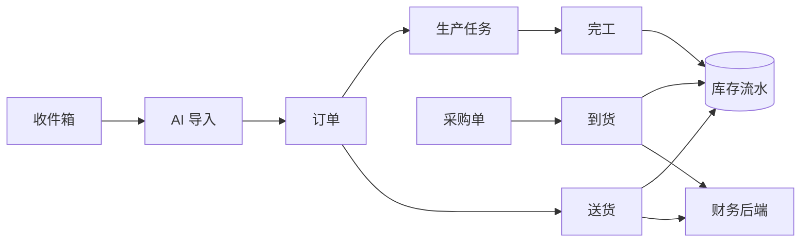

# 架构说明

系统现在是什么样。版本号以代码为准：`shared/version.ts`（软件）、`server/business/metadata.ts` 的 `CATALOG_VERSION`（业务目录）、`server/backup.ts` 的 `supportedDatabaseVersions`（数据库迁移）。

## 总览

**技术栈：** React 19、Vite、Express 5、`node:sqlite`、TypeScript，Node 24。前后端共用 `shared/` 里的类型和校验。

## 代码分层

| 目录 | 负责 |
|---|---|
| `src/` | 页面。`App.tsx` 装配，`src/editors/` 是客户、产品、订单编辑器，`src/flow/` 是单据编辑器和详情，`src/ui/` 是通用组件，`design.css` 是设计系统。样式都在 `main.tsx` 引入，`design.css` 最后，页面里不单独 import（`tests/css-order.test.ts` 会检查） |
| `shared/` | 前后端共用的字段规则、金额计算、导航、能力清单 |
| `server/app.ts`、`index.ts` | HTTP 装配和启动 |
| `server/business/` | 客户、产品、订单、归档、删除、审计、今日页 |
| `server/operations/` | 供应商、采购、库存档案和流水 |
| `server/flow/` | 到货、生产任务、完工、送货、排程 |
| `server/documents/` | 采购单、送货单的 Word/Excel 导出和模板 |
| `server/import/` | AI 导入工作区：原件、草稿、匹配、正式导入 |
| `server/inbox/` | 收件箱和企业微信机器人 |
| `server/marks/` | 产品唛头 |
| `src/finance/` | 财务页面，单独打包，用 `kit.tsx` 的通用表格和表单窗口 |
| `server/finance/` | 财务后端。来源扫描独立于实物流转，正式报表基于记账分录，经营报表另按单据和资金收付取数 |
| `server/assistant/` | 全局助手：调度、工具注册、任务台账、插件、页面控制 |
| `server/ai/` | 模型服务适配、密钥、提示词 |
| `server/speech/` | 可选的本地语音输入 |

## 业务主线

- **订单：** `status` 和发货进度分开。生产中、待发货、已发货由有效单据派生（`FlowService.updateOrders`）。未发完的每个“产品 + 单位”，同产品同单位任务的已完工数量都够这一组的订单数量才算待发货（`FlowService.producedEnough`）。同一产品多行合并计算；任务挂多张订单而没有分配记录时，把经由任务连在一起的订单当成一组，总完工够总需求才算。任务单位和订单单位不同的不换算、不计入。“部分发货”不存库，由 `orderDisplayStatus` 按发货进度派生，只用于显示和筛选；判断业务仍读 `status`。今日页的“可发货”看成品库存；“未排产”和订单下一步的排产提醒同一口径：状态还没做够，又没有未完工的同单位任务。派生规则改了时，启动时用 `FlowService.recomputeOrderStatusesOnce` 按标记全量重算一次，只写状态变了的订单并记审计，标记存在 `operation_requests`（`kind=order-status-recompute`）。
- **采购：** `businessStatus` 和到货进度分开。到货统一走正式到货事务，`receiptEvents` 负责合并新旧记录，同一批只算一次。
- **库存：** 余额只由 `stock_movements` 派生。数量是千分单位整数。更正靠追加冲销和替代流水。
- **生产和送货：** 单据存 `flow_documents`，关联查询走 `flow_refs` 索引。计划日期不影响实际业务和库存。
- **送货金额：** 确认时把价格、料号、订单号和本批金额写进单据快照，历史单据缺价格不猜。
- **产品唛头：** 只是参考资料，不产生订单、生产或库存。

## AI 导入

1. 上传原件，保存文件和哈希。
2. 用户选类型（客户订单、到货单、唛头）并触发识别。**上传和转单都不会自动发给模型。**
3. 识别结果进草稿，人工核对，匹配客户和产品。聊天里发起的识别绑定用户发消息时确认的模型配置，读原件前后各核一次，中途改了配置就停下。
4. 正式提交走 `ImportExecutionService`：完整预览、绑定版本和身份、事务、幂等、审计。

匹配规则集中在 `shared/import-matching.ts` 和 `shared/mark-matching.ts`，页面、助手和正式导入共用：

- **客户：** 只差公司后缀、括号、盖章字样的唯一档案直接对应；错别字、少字只作候选；名字里的数字不同不算相近。
- **产品：** 同名，或名称包含且只差括号里的说明、数字也一样，再加尺寸相同（一边没写单位时比数字，不换算）的唯一档案直接对应。其余名称包含（“纸箱1”和“纸箱10”、“纸箱”和“纸箱加厚”）、名字很像的只作候选；尺寸相同但名字无关的不拦新建。
- **唛头：** 料号、名称、尺寸依次取最强的依据，这一档唯一且无冲突就自动挂到产品。两边都有料号又对不上算冲突，名称相同也不自动挂。全部对应上就直接提交，由 `server/marks/mark-import.ts` 统一处理。

模型输出经 `shared/model-output.ts` 和 `server/ai/model-retry.ts` 清理，不合格自动重试一次。

Responses 协议服务直接传原件；DeepSeek 官方接口不支持文档，走明确说明过的文字提取或扫描 PDF 转图。不做本地 OCR。

## 全局助手

任务进度、预算和工具记录是开发排查用的，服务器照常记录，前台只在开发者模式显示。

工具参数给模型时压成短写法（`server/assistant/compact-schema.ts`），每次调用省约七成字数；“插件与工具”页面仍显示完整结构。系统维护、唛头、收件箱添加和到货识别工具在 `server/assistant/extra-tools.ts`，都复用页面用的原服务。

删除聊天记录（`chat.delete`）和移除唛头（`marks.remove`）的授权在服务器判断（`server/assistant/task-routing.ts` 的 `askedInChat`）：只看用户原话，不看模型的决定和文件内容。按分句判断，带否定（不删、取消删除、别清空）或只是问怎么做的不算；“能不能删”这类客气的问法要等下一句确认，确认必须是整句肯定的话。

助手的财务工具全部只读，金额给模型前统一换成元（`server/finance/assistant.ts`）。清空业务数据时财务已有记录就拒绝，交给页面操作。

- 只有一套调度：`AssistantManager`、`AssistantToolRegistry`、`AssistantTaskLedger`。
- 模型只能通过 JSON 信封选择注册工具。真实账号权限、插件和工具开关、参数校验都在服务端判断。写入复用业务服务。
- 附件、备注、收件箱、页面文字只算数据，不能授权操作。
- 任务按步持久化，继续时先核验回执，已成功的写入不重放。完成要以真实回执为准，不靠模型声明。
- 额度默认不限，超时 2 小时，由 `ERP_AGENT_*` 环境变量配置（`server/assistant/budget.ts`）。
- 页面控制（`page.*`）操作当前标签页；`browser.*` 操作独立的本机 ERP 窗口。都排除密码和密钥区域。
- 提示词分两层：`server/assistant/system-prompt.ts` 是代码里的回复格式、不能改变的规则、任务协议和当前信息；`default-preset.ts` 是用户能改的条目（工厂业务、工具规则、性格、分工、各业务流程）。没改过的默认预设自动升级，改过的只补缺少的条目。
- 小甬和小勒是一个模型的两种身份，不是两个智能体。信封里的 `speaker` 决定谁出面，`relay` 让另一位接一句，都存在消息的 document 字段里，不改表结构。模型没写或写错时，按最后用到的业务工具判断，再不行沿用上一位。分工不影响工具和权限。名字在 `shared/assistant-personas.ts`。
- 界面：展开时默认停靠右侧（`Ctrl+J`，可切浮动窗口），收起时默认是悬浮的小甬和小勒（可切到顶栏入口）。

工具清单见[功能链路表](功能链路表.md)和 `shared/ui-capabilities.ts`。

## 账号和权限

| 级别 | 权限 |
|---|---|
| 管理员 | `super_admin`，业务编辑、正式导入、恢复 |
| 业务人员 | 业务编辑、正式导入 |
| 只读 | 只能查看 |
| 财务 | 财务全部权限和业务编辑 |
| 出纳 | 财务查看和收付款 |

- `/api` 全局要求登录，只有 `/health`、`/auth/*` 例外。写操作还要 CSRF 令牌，并由服务层校验权限。
- AI 设置（`/api/ai/settings`）的写操作只有管理员能做；AI 导入工作区（`/api/ai/imports`）和提示词（`/api/ai/prompts`）的写操作要业务编辑权限。读取都放开，聊天和识别要用。
- 登录状态存内存，重启要重新登录。部署模式的会话存账号库，能跨正常重启。
- 申请账号（`/auth/apply`）和忘记密码（`/auth/forgot`）不用登录。两个接口都要 CSRF 令牌，按访客地址限频，回答不暴露账号是否存在。待处理的账号申请最多 50 条，超过 14 天自动删除；同名已在排队的不再收也不覆盖，同一地址最多占 3 条。
- 申请人的密码只存哈希，通过前不能登录，也没有任何权限。级别由管理员选，处理后申请记录连同哈希一起删除，结果记在 `auth_events`。
- 临时密码由管理员确认忘记密码或重置时生成，也可由命令行生成，24 小时内有效。生成后原密码和该账号的会话立即失效。还没改掉临时密码的会话，`AuthManager.actor()` 返回空，所有业务接口都当未登录，只有 `/auth/state`、`/auth/password`、`/auth/logout` 能用。
- 新设密码的规则在 `shared/password-policy.ts`，前后端共用。登录不检查规则，已有密码照常能用，系统生成的临时密码也不受这条限制。
- 切换账号就是退出再登录，不并存多个会话。浏览器只在 `localStorage` 记最近用过的用户名，不记密码和令牌。
- 本机管理员：`super_admin` 且请求确实来自本机、没有代理头，才能用本机数据管理（直接编辑、删除、初始化）。部署到服务器后这部分能力不可用。

## 数据存放

下表为 Windows 本机默认位置；`DB_PATH` 和 `ERP_BACKUP_DIR` 可覆盖数据及备份目录，Linux 凭据默认位置见下方“双平台目录与凭据”。

| 位置 | 内容 |
|---|---|
| `data/erp.sqlite` | 全部业务数据、助手聊天、收件箱、唛头。见[数据模型](数据模型.md) |
| `data/security/users.sqlite` | 账号及部署模式的登录会话 |
| `data/ai-imports/` | AI 导入工作区、原件、错误档案 |
| `data/ai-prompts/`、`data/ai-tools/` | 提示词、工具开关 |
| `data/snapshots/` | 删除、初始化或启动迁移前的业务库快照 |
| `backups/` | 完整备份 |
| `%LOCALAPPDATA%\ZhixuERP\ai\settings.sqlite` | 模型服务配置和加密密钥 |
| `%LOCALAPPDATA%\ZhixuERP\wecom\bot.sqlite` | 企业微信机器人凭据 |

凭据只在服务端保存：Windows 使用 DPAPI，Linux 使用 AES-256-GCM，主密钥单独保管。

部署模式使用两个回环端口。维护端口接收本机直连，代理端口只接受配置的公网 Host 和同机代理提供的单个 `X-ERP-Client-IP`。公网请求在代理端口始终按远程访问处理。详见[部署与运维](部署与运维.md)。

## 不要做的结构性改动

- 不新建第二套业务库、Agent 或工具注册表。
- 不删已有迁移，旧库升级还要用。
- 没有普通 import 的文件不一定是废弃的，先查[项目目录与维护](项目目录与维护.md)的“特别保留”。

截至 0.6.1 的详细设计演进见[旧版架构文档](history/架构说明-至0.6.1.md)。

## 双平台目录与凭据

凭据数据库结构不变：Windows 使用 CurrentUser DPAPI，兼容旧无标记密文，新写 `dpapi:v1:`；Linux 使用 AES-256-GCM，标记 `aes256gcm:v1:`。AI 和机器人共享平台保护器。`ERP_CONFIG_DIR` 覆盖凭据目录；Linux 默认 XDG 配置根目录下的 zhixu-erp，未设置时为 ~/.config/zhixu-erp；Windows 默认路径不变。Linux 的 credentials/master.key 要求服务账号所有、0600、无链接，凭据根目录及密钥目录 0700；启动前检查，主密钥不进入业务备份、日志和审计。迁移后重新填写凭据。

`DB_PATH` 指定业务库，工作区、原件、提示词和工具配置跟随业务数据目录；`ERP_BACKUP_DIR` 指定备份位置。Linux 使用 systemd 与 journald，维护端口和代理端口继续分离并只监听回环。详见部署文档。
