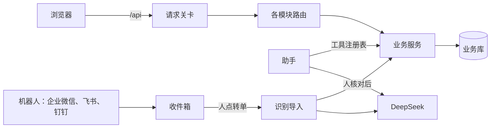
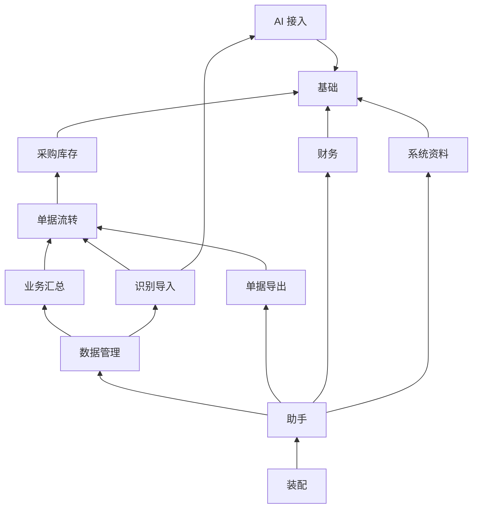

# 架构说明

系统怎么搭的：模块、目录、一次请求怎么走、几个关键机制。硬规则在 [AGENTS.md](../AGENTS.md)，这里不重抄；表和字段见[数据模型](数据模型.md)，功能对应的页面、地址、助手工具见[功能链路表](功能链路表.md)，界面写法见[界面规范](界面规范.md)。

版本号以代码为准：软件 `shared/core/version.ts`，业务库结构 `server/core/schema/version.ts` 的 `SCHEMA_LATEST`。

## 总览

React 19 + Vite 前端（哈希路由），Express 5 + `node:sqlite` 服务端，TypeScript，Node 24。前后端共用 `shared/` 里的类型、校验和计算。业务数据在一个业务库里，账号、AI 设置等在几个小配置库里（见[数据模型](数据模型.md)）。模型服务只接 DeepSeek。

## 模块

服务端、共用、前端按同一套模块分目录。模块规则（只往下用、只走接口、没有循环、前端走服务接口、表只由主人写）见 AGENTS.md“模块”。模块归属和允许的依赖登记在 `tests/module-map.ts`；`tests/module-boundaries.test.ts` 查引用，`tests/module-api-owners.test.ts` 查前端请求的地址（地址前缀归属 `apiOwners`），`tests/module-table-owners.test.ts` 查表（表的主人 `tableOwnerList`），`tests/css-modules.test.ts` 查样式里的类名（模块、能用谁、层都读 `tests/module-map.ts`）。改规则时同步改本节。

**模块里的分层：** 前端业务和共用业务两个模块内部再分层，层登记在 `tests/module-map.ts` 规则的 `layers`，同一模块里只能用本层和下层的，代码和样式都查；分了层的模块每个文件（前端按目录、共用业务按文件）都要登记进某一层，入口 `index.ts`、`pages.ts` 不用登记。

- **前端业务四层：** 业务公共件（`src/recordkit/`、`src/marks/`、`src/editors/`）← 单据（`src/flow/`）← 采购仓储（`src/operations/`、`src/warehouse/`）← 页面（`src/records/`）。上层嵌下层的窗口，下层要打开上层的页面用页面地址，不引上层的代码。单据在采购仓储下面，和服务端的顺序不同：采购、仓储页面要显示到货单、送货单，单据窗口用不着采购窗口。
- **共用业务三层（`shared/business/` 按文件分）：** 采购库存 ← 单据流转 ← 业务汇总，和服务端同序。服务端这三个模块用共用业务也按这个限：经 `shared/business/index.ts` 引的名字按来源文件算层，看不出名字的引用（`import * as`、不带名字的 `import(…)`、入口里查不到来源的名字）直接报，要改成写名字的引用；共用业务的每个层名都要对得上一个服务端模块名。
- **怎么查：** `tests/module-boundaries.test.ts` 查代码引用；`tests/css-modules.test.ts` 查样式，一条选择器只能写本层和下层的类名（类名的层按写出它的最低一层目录算）。代码和样式都已经没有越层的，一处都不许有：下层要用的东西放在下层那一份（比如采购单视图里的到货记录，单头和明细的结构在采购库存那一份 `operations-views.ts`，单据流转的到货事件在它上面加原单内容）。其余模块内部不登记层，按 AGENTS.md“文件怎么分”。

| 模块 | 管什么 | 服务端 | 共用 | 前端 |
|---|---|---|---|---|
| 基础 | 业务库建表和升级（`schema/`）、配置库版本、客户产品订单读写（`Store`，`db.ts`、`products.ts`）、取号、防重复提交、登录账号和权限、审计、统一报错（`errors.ts` 含 `unsupportedFile`）、归档恢复的统一做法（`archive.ts`）、流式写出（`stream.ts`）、备份和快照（含 `backup-manifest.ts`）、每日清理、出错记录（`diagnostics/`：请求关卡记失败的请求、页面上报 `/api/diagnostics`、最近出错的读取，另有读取的权限分页和遮密钥给系统资料用）；给上层登记用的接口 | `server/core/`（附件头和 Office 校验在 `image-size.ts`、`office-validation.ts`，`sql.ts` 含 `integrityPassed`） | `shared/core/`（金额精度和显示、数量读法、单位、日期和时区、订单结构 `order-view.ts`、度量单位 `measures.ts`、列表分页 `paging.ts`、批量归档正文 `archive-input.ts`、接口表工具 `api-table.ts` 与 `is-record.ts`、预览冲突 `preview-digest.ts`、账号 `accounts.ts`/`account-input.ts`/`account-api.ts`、报错 `diagnostics-api.ts`、`user-errors.ts`、账号范围） | `src/ui/`（通用组件、请求 `http.ts`/`call.ts`/`read-body.ts`、读事件流 `event-stream.ts`、认证状态 `auth-state.ts`、插槽、事件、北京时间 `time.ts`、`Markdown.tsx`、样式变量 `tokens.css`） |
| 系统资料 | 给助手和管理员排查、查阅的只读资料：运行日志（`run-log.ts`）、登录记录（`login-records.ts`）、读程序代码（`source-reader.ts`、`source-paths.ts`）、使用手册（`user-manual.ts`，`GET /api/guide`）；只有助手和装配在用。出错记录是请求关卡和页面上报写的，留在基础 | `server/system/` | `shared/system/`（使用说明接口表 `guide-api.ts`） | `src/system/`（使用说明页 `GuidePage.tsx`，请求在 `guide-api.ts`） |
| AI 接入 | 发给 DeepSeek 的唯一出口、密钥和设置、提示词库（`prompt-presets.ts`、`recognition-modules.ts` 的 `createPromptManagers`；默认内容由用它的模块提供、装配传进来，订单和送货单识别的在识别导入 `server/import/default-prompts/`，助手的在 `server/assistant/default-prompt.ts`）；DeepSeek 回的 JSON 都经 `transport.ts` 的 `readShaped` 按结构核对，不合就报“格式不对”；对话收发在 `chat-reply.ts`、`chat-receiver.ts`、`chat-exchange.ts` | `server/ai/` | `shared/ai/`（接口表 `ai-settings-api.ts`、`prompt-api.ts` 和正文规则 `ai-settings-input.ts`、`prompt-presets.ts`、`prompt-modules.ts`） | 没有自己的页面，设置页在数据管理 |
| 采购库存 | 供应商、采购单、库存品和流水、订货单（订货批次）、往来单位筛选 | `server/operations/` | `shared/business/`（业务主线三层共用，按文件分三层，见上） | `src/` 下业务页面合成一个前端模块，分四层（见上）：`records/`、`recordkit/`、`flow/`、`warehouse/`、`operations/`、`editors/`、`marks/` |
| 单据流转 | 到货（登记、更正、撤销）、生产任务、完工、送货、采购退货、排程、成品批次、订单进度派生、管理员改数据后的连带处理 | `server/flow/` | 同上 | 同上 |
| 业务汇总 | 客户产品订单的保存入口、订单状态动作、今日和经营概况、关联记录和修改历史、档案“什么时候不能归档”、产品唛头、删除引擎 | `server/business/` | 同上 | 同上 |
| 财务 | 财务事件、凭证账簿、往来、资金发票、费用资产工资、成本、结账报表 | `server/finance/` | `shared/finance/` | `src/finance/`（单独打包） |
| 单据导出 | 采购单、订货单、送货单的 Word/Excel、导出记录、模板设置（拼单据内容在 `forms.ts`、`delivery-form.ts`、`purchase-form.ts`，送货单材质和楞型优先取已出库或留下的明细、待送货取产品档案；导出前核对在 `export-checks.ts`，每种纸的尺寸在 `paper.ts`） | `server/documents/` | `shared/documents/`（接口表 `documents-api.ts`、单据内容类型 `business-form.ts`、导出记录 `export-record.ts`） | `src/documents/`（导出窗、模板设置、文件交付；业务页面和助手经它的 `index.ts`、`pages.ts` 用） |
| 识别导入 | AI 导入工作区、订单和到货单识别、正式导入、收件箱和三家机器人 | `server/import/`、`server/inbox/` | `shared/import/` | `src/import/` |
| 数据管理 | 初始化、本机管理员改业务数据（已生效的单据也只走编辑说明和更正）、工作区管理；没有自己的表。命令入口 `DataManagementService.execute`，按模块读记录在 `managed-records.ts`（各模块的录入结构 `inputSchemas`），保存一条在 `managed-save.ts`：先按录入结构逐层（明细、纸板资料也查）找补丁里不收的栏目（`input-fields.ts`），照读出来的记录原样带回的（已发数量、金额这类算出来的）放过，改了值的、记录里没有的拒收，报错的中文叫法在 `field-rejection.ts`；已生效的单据按改了哪些录入栏目（原样带回的不算）分说明编辑和指向更正 | `server/admin/` | `shared/admin/`（接口表、初始化的范围请求预览、页面命令、识别文件命令） | `src/admin/`（也放 AI 设置、提示词、消息接入设置页） |
| 助手 | 全局助手：对话内核、工具注册表和命令目录、工具分组、确认卡片、长期记忆、看页面、语音输入和朗读（`speech/`，浏览器和服务端共用的约定在 `shared/assistant/speech.ts`） | `server/assistant/` | `shared/assistant/` | `src/assistant/` |
| 装配 | 启动、挂路由、请求关卡、命令行；前端入口、导航、登录、设置总页、插槽装配 | `server/` 根目录 | — | `src/` 根目录、`src/mobile/` |

箭头读作“用”，只画直接的一层，顺着箭头能走到的都能用。财务只连基础：它按表只读业务数据，不调用业务服务，业务也不调用财务。数据管理 → 识别导入只引类型。共用代码：共用-基础、共用-AI 不用别的；共用-业务、共用-财务用共用-基础；共用-单据、共用-管理用共用-基础和共用-业务；共用-识别用共用-基础和共用-AI；共用-系统资料不用别的；共用-助手用共用-基础、共用-业务、共用-AI。前端：基础 ← 单据导出 ← 业务 ← 识别、管理、助手（前端单据导出只用共用-基础、共用-单据，排在前端业务下面是因为业务页面嵌它的导出窗，和服务端的先后相反；前端助手也直接用单据导出；前端系统资料（使用说明页）只用基础，由装配引；前端管理还用共用-AI、共用-识别，前端助手不用共用-识别），财务只用基础；装配用全部。前端业务、共用业务内部的层见上面“模块里的分层”。

### 低层要用高层的东西

| 做法 | 用在哪 | 例子 |
|---|---|---|
| 调用方传入 | 服务端低层函数要高层的数据 | 每日清理的各项由 `server/index.ts` 传给 `scheduleDailyCleanup`；归档时“读状态、打标记、审计”由各模块给 `server/core/archive.ts` 的 `changeArchive`（`ArchiveTarget`） |
| 登记 | 低层的事要高层配合：低层定义接口，高层模块加载时登记实现，没登记就报错 | 订单进度（`server/core/order-hooks.ts` 的 `registerOrderRules`，单据流转登记）；产品改了成品库存跟着改（`server/core/db.ts` 的 `registerProductStockSync`，采购库存登记）；管理员改库存品、采购明细时连带改单据（`server/operations/hooks.ts`，单据流转登记）；删除和初始化规则（`server/core/deletion-rules.ts`）；配置库默认位置（`registerVersionedSqlite`） |
| 插槽 | 前端低层页面里放高层模块的东西（`src/ui/slots.tsx` 定义，`src/slots.ts` 装配，没填就不显示） | 订单、送货、到货详情的“财务”段（`FinanceRelatedSlot` 先看 `canViewFinance`，没有 `finance:view` 不渲染，也不下载财务段）；到货页的“AI 识别送货单”；保存内存里的文件 `saveFile`（`src/slots.ts` 在安卓 App 里填“交给 App 存”，没填是浏览器下载，见下面“安卓 App 通道”） |
| 服务接口 | 前端读写别的模块的数据（定义在 `src/ui/slots.tsx`，各模块 `services.ts` 实现） | 今日页的收件箱和到期应收应付；识别导入里复制识别文件（`AdminService.forkWorkspace`） |
| 事件 | 前端模块之间通知（`src/ui/events.ts` 登记，`emit`、`listen`） | 数据变了刷新列表；打开助手 |
| 按需加载 | 用到才下载：导航打开整页，模块的 `pages.ts` 只给 `lazy()` 用；别的模块只用一小段时另立入口，登记在 `tests/module-map.ts` 的 `lazyEntries`（写明理由）；点了才开的窗口在模块里直接 `lazy()`，外面包 `Suspense` 显示“正在打开…” | 整页 `src/finance/pages.ts` 等，汇总在 `src/lazy-pages.ts`；详情里的财务段 `src/finance/related-pages.ts`（由 `src/slots.ts` 装配）；删除窗、更正到货单窗（`src/records/BusinessRecords.tsx`），客户、产品、订单编辑窗（`src/records/RecordEditors.tsx`）。这些不许进首屏，见下面“首屏体积上限” |

单独测某个模块时，要先加载负责登记的模块（比如测删订单先 `import '../server/import/index.js'`），正式启动时全部模块都加载。

## 目录

| 位置 | 放什么 |
|---|---|
| `server/` 根目录 | `index.ts` 正式启动（按真实数据目录启动，不要直接运行或加载）、`app.ts` 挂路由（测试和预览实例从这里起）、`local-service.ts` 本机服务名和默认端口、`http-guards.ts` 请求关卡、`http-errors.ts` 统一出错回答、`maintenance.ts` 维护命令行（`backup`、`restore`、`reset-password`、`revert-config-upgrades`）、`stop.ts` |
| `server/<模块>/`、`shared/<模块>/`、`src/<模块>/` | 各模块代码；对外只走 `index.ts`（按需加载的整页走 `pages.ts`），新建目录先在 `tests/module-map.ts` 登记归属 |
| `server/core/schema/` | 业务库结构，见下面“数据库结构版本” |
| `src/` 根目录 | `main.tsx`（入口，全部样式在这里引入、定先后）、`App.tsx` 和外壳的 hook `app-shell.ts`、`shell-api.ts`（AI 状态请求）、`AppTopbar.tsx`、`Navigation.tsx`、`slots.ts`（插槽装配，顺带接上安卓 App 通道）、`lazy-pages.ts`、登录页（`LoginScreen.tsx`、`LoginViews.tsx`，请求在 `auth-api.ts`）和账号菜单、安卓 App 通道 `app-bridge.ts` 和 App 里保存文件 `app-save.ts`（见下面“安卓 App 通道”）、装配层的样式 |
| 样式 | 和组件放在同一个模块目录（`src/ui/` 是基础件和变量 `tokens.css`），规矩见下面“前端约定” |
| `public/` | `theme-init.js`（首屏主题，`index.html` 直接引用）、`favicon.svg` |
| `scripts/` | 启停（`start-system.mjs`、`dev-system.mjs`、`runtime-control.mjs`，后者 `server/index.ts`、`server/stop.ts` 也用）、构建（`build.mjs`）、测试（`run-tests.mjs`；用时和慢测试 `test-reporter.mjs`、`test-report.mjs`、`test-slow.mjs`，覆盖 `test-coverage.mjs`，例外登记表 `test-exemptions.mjs`；`test-related.mjs`）、体检（`check.mjs`、函数复杂度基线 `complexity-ratchet.mjs`；两个外壳的检查 `check-apps.mjs`）、发布和补丁（`package-release.mjs`、`release-files.mjs` 程序文件清单、`release-scan.mjs`、`release-audit.mjs`、`patch-server.mjs`）、`schema-dump.ts`（配置库的基线快照由它调 `config-db-dump.ts` 导出）、`linux/`（服务器维护脚本、systemd、Caddy 示例；补丁在服务器上由 `apply-patch.mjs` 执行，纯逻辑在同目录 `patch-logic.mjs`、回滚时的数据步骤（先换回配置库再看业务库）在 `patch-rollback.mjs`；它引的同目录文件都要列进 `patch-server.mjs` 的 `applyScripts` 才会一起上传，`tests/release/patch-and-package.test.ts` 守着；Linux 验证脚本见下面“几组手动跑的比对和验证脚本”）、`ui-check/`（界面实测，见 `.claude/skills/ui-check/SKILL.md`；样式比对、识别前后对比也在这里） |
| `tests/` | `*.test.ts`、`*.test.mjs`（`npm test`）、`*-fixture.ts`（准备代码，见下面）、`serial/`（串行组：启动器验收，单独跑）、`release/`（发布检查和要起构建、打包进程的测试，`npm run test:release`）、`fixtures/`（只放测试数据：结构快照 `schema-v20.sql`、公开格式样例、升级步骤的数据样例）；别的子目录里的测试都归主套件 |
| 根目录的检查配置 | `eslint.config.js` 和已清空的豁免登记 `eslint-suppressions.json`（`npm run lint`）、`stylelint.config.mjs`（`npm run lint:css`）、`knip.json`（`npm run knip`）；持续集成 `.github/workflows/` |
| `docs/` | 文档；`brand/` 商标原图（改商标时 `src/ui/BrandLogo.tsx`、`public/favicon.svg` 一起改） |
| `apps/` | 两个应用外壳，各自成一体、不引用项目其余代码：`apps/android/`（安卓，原生 Java WebView，Gradle 构建）、`apps/desktop/`（Windows，Rust + Tauri 2）；只是打开 ERP 网址的窗口，和网页唯一的代码接点是下面“安卓 App 通道”。各自的结构、检查和打包见它们的 `docs/`；检查 `npm run check:apps`（`scripts/check-apps.mjs`），持续集成 `.github/workflows/apps.yml` 只在 `apps/` 改了时跑 |
| `启动系统.cmd`、`停止系统.cmd` | Windows 本机启停 |

**测试怎么跑：** `npm test` 由 `scripts/run-tests.mjs` 分组并行跑（默认最多 8 组，`TEST_JOBS` 可改）：按上次记下的每份文件用时装箱（用时表在 `node_modules/.cache/erp-tests/timings.json`，跑完更新，所以同一份文件不保证每次落在同一组）。同组共用进程，改了 `process.env`、`cwd`、模块级缓存要自己恢复；怀疑互相影响用 `npm run test:isolated` 对照。测试进程的 `LOCALAPPDATA`、`ERP_CONFIG_DIR`、`XDG_CONFIG_HOME`、`DB_PATH`、`ERP_BACKUP_DIR` 都指向新建的临时目录，忘了传路径的测试打开的也是临时目录里的空库。并行时单条超过 1 秒的，把它所在的文件单独重跑一次再计时（`scripts/test-slow.mjs`：串行、一轮最多 6 份、用时最长的先判，没轮到的在结尾提示），单独跑也超过 1 秒才算慢测试；`npm run test:coverage` 按文件报 `server/`、`shared/` 的行覆盖，低于 80% 的列出来。这两项不达标都拦下（慢测试的 1 秒是按开发机定的，持续集成的机器慢好几倍，在那边只报不拦），确实快不了、测不到的登记在 `scripts/test-exemptions.mjs` 并写原因。登记表不留过期的条目：登记的文件不在了（`tests/test-exemptions-current.test.mjs`）、慢测试登记的那条在文件里找不到了（`npm test`）、低覆盖登记的文件覆盖已经达标（`npm run test:coverage`）都算失败；慢测试单独跑已经不慢了只提示（和机器快慢有关），几次都不慢再删。测试文件连子目录一起找：`tests/release/` 是发布检查、`tests/serial/` 是串行组、`tests/fixtures/` 只放数据，其余都归主套件（`scripts/run-tests.mjs` 的 `suites`，`scripts/test-related.mjs` 用同一份）；`tests/test-suites.test.mjs` 查每个看着像测试的文件恰好属于一个套件，运行器只认 `.test.ts`、`.test.mjs`，写成别的后缀或放进 `fixtures/` 的会被报出来。全部体检一条命令 `npm run check`（`scripts/check.mjs`，顺序：类型检查 → 代码检查 → 函数只许变小 → 样式写死的值 → 没人用的代码 → 重复代码 → 完整测试 → 覆盖 → 发布检查 → 构建），持续集成（`.github/workflows/check.yml`）推送时在 Linux、Windows 各跑它，推到主分支再跑界面流程；界面流程本机用 `npm run test:ui`，各组跑哪些流程登记在 `scripts/ui-check/run.mjs` 的组表，`tests/ui-check-groups.test.mjs` 查 `scripts/ui-check/` 下每个流程脚本都在某一组、只在一组，组表写的都存在。

推送 `ci-` 开头的分支也会运行持续集成的界面流程。

**首屏体积上限**（`tests/release/first-screen-size.test.ts`，在发布检查里）：构建到临时目录、读 Vite 自带的 manifest，取入口块和顺着静态引用带进来的块（按需加载的、样式不算），gzip 9 级后加总。超过上限失败；比上限小 5% 以上也失败，报错给出新的实测数和上限，照着把上限调低。上限只许调低：测试另查上限不超过实测加 3%；实测数和上限一起往上改它拦不住，靠审查。量的日期、实测数、上限只写在测试的 `FIRST_SCREEN_LIMIT`。点了才用的窗口和财务段列在测试的 `NOT_IN_FIRST_SCREEN`：同一次构建写出 hidden source map，按每块的源文件查，名单里的文件进了首屏块就失败，哪块都找不到（改了名）也失败。这条测试自己构建一遍，多花约 6 秒。

**几组手动跑的比对和验证脚本**（不在 `npm run check` 里）：

- **样式比对**（`scripts/ui-check/style-compare.mjs`；页面和状态清单 `style-scenes.mjs`，页面里取样式和记命中 `style-page.mjs`，比较和出结果 `style-diff.mjs`）：改样式前 `node scripts/ui-check/style-compare.mjs baseline` 存基线（默认跑两遍，两遍之间会变的记成抖动；`--once` 只跑一遍），改完 `compare` 再跑一遍比：逐元素比计算后的样式和位置大小、逐像素比截图，结果写进目录里的“对比结果.md”，有差异退出码 1；同时列出从没命中过的样式规则（对回 `src/` 的文件和行号）。`diff` 只把已有结果重比一次，`--list` 列状态。选项 `--dir`、`--modes desktop-light,mobile-dark`、`--only 正则`、`--port`（默认 3195）。自己构建到临时目录、起虚构数据的隔离实例（和 `npm run test:ui` 同一套 `scripts/ui-check/server.mts`），不碰真实数据和 `dist`；前后两次要在同一天、用同一份组件代码跑。
- **识别前后对比**（`scripts/ui-check/real-recognition.mjs`；虚构文件和标准答案 `real-recognition-cases.mjs`，按栏打分 `real-recognition-score.mjs`）：直接走识别导入的接口（上传 → 识别 → 读结果），每份跑几遍，按栏比读对没有、“拿不准”报得准不准、空着的是不是原件真没写，另记请求次数、token、秒数。`--start --port 3196 --label 改后 --yes` 自己起真实模型实例跑（会花钱，先问用户），`--compare 改前目录 改后目录` 按现在的标准答案重新打分对比。
- **Linux 验证**（`scripts/linux/`，在 Linux 上用虚构数据跑，步骤见[部署与运维](部署与运维.md)“打包和 Linux 验证”）：`verify-runtime.mjs` 原生依赖和几种纸张的单据排版冒烟；`verify-layout.mjs` 在 Windows 生成排版基准、Linux 逐格比接受、缩字、拒绝的边界（`node --import tsx scripts/linux/verify-layout.mjs 输出.json [Windows基准.json]`）；`verify-package.mjs` 在解压后的发布包里用包里带的 Node 跑（`--import tsx`），核对包标记、用虚构数据起隔离服务、建管理员、导出各种单据核哈希和行数、备份 → 停止 → 恢复 → 重置密码。

两个外壳不在 `npm run check` 里（要另装 JDK、安卓 SDK、Rust）：本机用 `npm run check:apps`（`scripts/check-apps.mjs`，全部离线：安卓跑 `gradlew --offline check`，即 Lint、javac 告警、Checkstyle、运行时依赖为空、单元测试；Windows 跑 `cargo fmt --check` → `cargo clippy --all-targets -D warnings` → `cargo test` → 边界检查；只跑一个加 `-- android` 或 `-- desktop`；工具链在 `%LOCALAPPDATA%\YongleToolchains\` 下，找不到就报缺什么、不跑）；持续集成是单独的 `.github/workflows/apps.yml`，只在 `apps/` 或它自己改了时跑（安卓在 Linux、Windows 外壳在 Windows），端到端和真机测试不进持续集成。

**测试的准备代码**（`tests/*-fixture.ts`，搭环境只用这些，不在测试文件里再抄一份）：起真实服务用 `http-fixture.ts`（`startHttp` 登录好的服务和发请求的 `send`、`get`、`post`，`h.enterSuperMode()` 进超级管理员模式；`startProxied` 模拟从域名经代理访问；`listen` 起不要登录的服务）；借一个账号用 `actor-fixture.ts`（`pageActor` 造身份，现成的 `actor`、`superActor`，换一套权限写 `{ ...actor, permissions: grant(...) }`，`grant` 只收权限名单里的名字；不引任何业务模块和助手）；从结果里取数用 `read-result.ts`（`readAs` 按结构取、`must` 一定有）；建客户、产品、供应商、纸板、成品、订单和“预览再核对”只用 `business-base-fixture.ts`（`businessBase`，最常用的一套是 `standardRecords`），别的准备代码都在它上面搭（`flow-fixture.ts`、`maintenance-fixture.ts` 等常用的把它交出来叫 `base`，测试里补建档、核对单据用 `f.base`），以后拆客户产品订单、采购库存主要改它；一套虚构业务数据用 `stack-fixture.ts`（`orderBasics`、`stackFixture`）和 `flow-fixture.ts`（`flowFixture`、`businessFixture`、`workbenchFixture`）；各模块自己的（财务 `finance-fixture.ts` 的 `monthEndJobs`、`closeMonth`，单据导出 `document-fixture.ts` 的 `zipEntries`、`wordXml`、`allRows`，助手 `assistant-fixture.ts`（自动确认的是 `autoConfirmAssistant`），模型替身 `fake-deepseek.ts`，能卡住的密码哈希 `hash-gate.ts` 等）归那个模块的测试用。

**代码检查：** `npm run lint`（`eslint server shared src scripts tests`，约 35 秒）按 `eslint.config.js` 查任意类型和强行断言、非空断言、没等待的异步和抓真错的几条、废弃写法、出错后什么都不做、危险的正则、前端组件的 hook 依赖、函数长度和复杂度；带类型信息，所以不带缓存；测试目录和程序一样查（只有 `no-floating-promises` 放过 `node:test` 的 `test` 这类）。源码里写 `eslint-disable` 不起作用（`noInlineConfig`）；豁免登记 `eslint-suppressions.json` 已清空，不许再登记，报一处就失败。`npm run lint:ratchet`（`scripts/complexity-ratchet.mjs`）不带豁免再量一遍函数的行数、嵌套、参数、复杂度，和基线 `scripts/complexity-baseline.json`（现在 0 项）比，超线的新函数和变大的都拦。另有几条按位置或写法管的：写死的数字（只查 `server/`、`shared/`；0、1、2、100、1000、-1 和数组下标、默认值放过，HTTP 状态码按位置放过，`res.status(409)`、`new AppError(…, 404)` 这类不起名）；服务端不许直接读库（`prepare(…).get/all/iterate`，读库只走 `one`、`many`、`exists`、`count`）；前端发请求的函数（`call`、`request`、`throwIfFailed`、`authorizedRequest`、`tokenRequest`、`retryWhenBusy`）只许在 `*-api.ts` 和 `src/ui` 里引（`@typescript-eslint/no-restricted-imports`）；`trustedReply` 只许 `src/ui` 自己用，`responseData`、`readEventStream` 可在 `src/ui` 和登记的三个调用文件使用（`settings-api.ts`、`workspace-api.ts`、`useAssistantChat.ts`）。直接验证这些读取函数的三份测试也有定向例外（`no-restricted-imports`）；`z.custom()` 必须带校验函数（全项目禁用空参）；zod 对象里值为 `z.unknown()`、`z.any()` 的键必须写 `.optional()`（`server/assistant/tools/**` 参数结构除外）。前两条是项目自己补的规则，在 `scripts/eslint-local-rules.mjs`（在现成规则上加按位置、按类型的判断）。接住的出错要写成文字时用 `shared/core` 的 `errorMessage(e)`。

**防两套和文档的检查：** 每个会写库的地址和助手写入命令登记成一条业务动作，登记表在 `shared/assistant/ui-actions.ts`（账号、助手、设置、数据管理在 `ui-actions-system.ts`）：记录、动词、按钮叫法、写地址、预览地址、服务函数、助手命令，每条挂在 `ui-capabilities.ts` 的一项能力上（能力表管功能、页面、工具，动作表管写地址）。检查分四份：`tests/feature-links-actions.test.ts`（服务端每个写地址正好属于一条动作、同一种记录同一个动词只许一条、会写库的助手命令都挂在动作上且调的是登记的服务）、`tests/feature-links-senders.test.ts`（一个写地址前端只有一个文件发）、`tests/feature-links-status.test.ts`（单据、订单、采购单、采购退货的状态只在登记的文件里改）、`tests/feature-links-labels.test.ts`（带动作词的按钮字要是某条动作的叫法，对不上就失败，清单在失败输出里，也可以 `node --import tsx tests/feature-links-labels.test.ts` 看）。路由是装一遍应用在运行时取的（`tests/server-routes.ts`），循环拼出来的地址也取得到；财务的写地址也都登记了，没有整块暂不登记的前缀。`tests/doc-paths.test.ts` 查文档里反引号写的项目路径都存在（举例和要新建的文件登记在里面）；`tests/file-size.test.ts` 也管测试、脚本和 `apps/` 下两个外壳的源码、测试、脚本（构建产物不算）。

**两边写的清单对得上的检查**（都从现有的结构和名单取数、真算或真拼，不手抄字段表；现在就对不上的登记在测试里，只许减少）：

- `tests/finance-source-contract.test.ts`：单据和财务的约定（`shared/business/finance-source.ts`），直接比结构。① 栏目归类表 `financeFieldClasses` 登记的每一层，栏目和业务的单据结构一个不多、一个不少，算进指纹的栏目里套着对象的那一层也要登记；② 到货、送货、完工单归“说明”的栏目改了，来源指纹用的内容（`financialContent`）不变。
- `tests/data-management-template-fields.test.ts`：数据管理新建模板和录入结构（`server/admin/managed-records.ts` 的 `inputSchemas`）的栏目两边对得上；不给新建时填的在 `notInTemplate` 写原因，已有的对不上在 `knownGaps`（待定，见[路线图](路线图.md)）。
- `tests/document-field-names.test.ts`：用虚构数据真拼几份送货单、订货单，写出的信息格名字排版（`shared/documents/document-layout.ts` 的 `splitFields`、`templateInfoFields`，预览和导出共用）都认得、排了的都有人写；可隐藏清单 `optionalDocumentFields` 的每一格都有单据写、勾了隐藏就不再出现。
- `tests/upgrade-step-samples.test.ts`：`server/core/schema/steps.ts` 的每个升级步骤都带一份升级前后的数据样例，从第 20 版快照建库、跑这一步、逐表比对；样例怎么写见 `server/core/schema/steps.ts` 和这条测试的开头。

`tsconfig.json` 开着 `noUnusedLocals`、`noUnusedParameters`、`noFallthroughCasesInSwitch`、`noImplicitOverride`，`scripts/` 的 `.ts`、`.mts` 也在类型检查里（开了 `allowImportingTsExtensions`，脚本由 tsx 运行）。新增运行时要用的脚本或目录，加进 `scripts/release-files.mjs`。

## 一次请求怎么走

1. **前端：** 一律经 `src/ui/http.ts` 的 `request` 发（`call()` 的 `authorizedRequest`、AI 导入与设置页带 `X-ERP-AI-Token` 页面凭证的 `tokenRequest`、上传的 `uploadFile` 都经过它；只有 `src/ui` 的请求入口直接调 `fetch`，上传只走 `uploadFile`，`tests/frontend-request.test.ts` 守着）。每个模块的请求收在自己的接口文件里（`flow/flow-api.ts`、`warehouse/stock-api.ts`、`warehouse/order-batch-api.ts`、`operations/purchase-api.ts`、`assistant/assistant-api.ts`、`admin/settings-api.ts`、`admin/data-api.ts`、`admin/account-api.ts`、`src/auth-api.ts`、`src/shell-api.ts` 等；财务页面读用 `useFinRead` / `useFinLoad`、接口文件用 `finRead`，写入在各子目录的 `*-api.ts` 用 `call<FinanceWrites>()` 发并经 `finWritten` 刷新，`finance/fin-api.ts` 只放共用读写小件、权限和全取资金账户），组件和 hook 只调这些函数、不直接写地址；同一个写地址只由一个函数发。`uploadFile`、`src/ui/read-body.ts` 的 `readJson` 返回 `unknown` 由调用方按结构认（另有 `textField`、`parseAuthState`）；回答读取函数的使用范围见上面的“代码检查”。带页面凭证的 `call()` 本地还没登录时说 `signedOutMessage`（“请先登录账号。”）、不发；只有 401 回登录页；网络断开换成“连不上服务器，请检查网络后再试。”；服务器回“正忙”（429、`busy`）时按 `Retry-After` 停一下自动再发一次（`retryWhenBusy`，登录和带页面凭证的请求经过它）；失败的请求和页面报错上报到出错记录（`src/ui/problem-report.ts`）。助手回复和识别进度这类事件流由 `src/ui/event-stream.ts` 的 `readEventStream` 读。
2. **关卡（`server/http-guards.ts`，按顺序）：** 记录失败请求 → 安全响应头 → 只许本机或登记的代理域名、核对来源、写请求只收 JSON（几个上传入口除外）→ 纯财务账号只能用财务接口（`shared/core/account-scope.ts`）→ 除 `/api/health`、`/api/auth/*` 外要登录 → 写接口要页面凭证（`/api/auth/*`、`/api/ai/*` 用各自的凭证）。
3. **路由 → 服务：** 路由只取参数；服务里查权限（`requirePermission`）、版本校验、事务、请求号防重复、审计，见 AGENTS.md“写入”。
   - **接口表：** 一个模块的地址、请求和回答写成一张类型表，放在 `shared/<路由主人模块>/<名字>-api.ts`（主人照 `tests/module-api-owners.test.ts` 的前缀登记），样板是 `shared/business/records-api.ts`（客户、产品、订单）。键写 `'方法 /地址'`（不带 `/api`，路径参数 `:name`），每个键给 `query`（对象，值只能是 string、number、boolean）、`body`（写接口必须有），两样都照服务端的 zod 规则写 `z.input<typeof …>`、不手抄（规则放共用代码里，服务端用同一份校验，样板 `shared/business/record-queries.ts`）、`response`（只能是 JSON 原样来回的值，时间写 ISO 字符串，用 type 不用 interface）；同一地址按查询参数回不同形状的，每种形状一个键（`'GET /orders'`、`'GET /orders?withMetrics=1'`），一组同样的地址用映射类型。类型工具在 `shared/core/api-table.ts`（含 `ApiJson`、`Empty`）。服务端用 `server/core/route.ts` 的 `route<表>(router)` 注册（路由挂在前缀下的写 `route<表>(router, '/前缀')`，表里的键照样写完整地址，比如财务 `route<FinanceApi>(router, '/finance')`、数据管理 `route<DataManagementApi>(router, '/management')`）：返回值按表查（带问号的键取并集），`param('名字')` 只能取键里有的，`query`、`body` 交出来是 `unknown`、进服务先 zod 校验，不读 `req.body`、`req.query`；找不到用 `notFound('说明')`（抛 404 的 `AppError`，code `not-found`），新建要 201 给 `{ status: 201 }`，只回状态码或 `{ message }` 的旧式拒绝用 `refuse(状态码, 说法?)`，无内容成功回 `done`（`{ ok: true }`），响应只经 `reply`（仅 `cache`、`cookie`、`clearCookie`）不拿原生 `Response`；服务按种类回不同类型的用映射对象分派（`server/business/service.ts` 的 `savers`），不用断言。前端在本模块 `*-api.ts` 里用 `src/ui/call.ts` 的 `call<表>()` 建发请求的函数（建出来的不导出给组件），走 `authorizedRequest`：读写都带页面凭证，本地没登录说 `signedOutMessage`、不发，403 换新凭证重发一次；不做运行时校验（AI 导入、AI 设置、提示词带 `X-ERP-AI-Token` 走 `tokenRequest` 按表发）。tsc 对不上就编译不过（`tests/api-table.test.ts` 守着），`module-api-owners`、`feature-links-senders`、`feature-links-actions`、`frontend-request` 都认 `call()` 和 `route()`。现在的接口表：基础 `shared/core/account-api.ts`、`diagnostics-api.ts`、`guide-api.ts`，AI 接入 `shared/ai/ai-settings-api.ts`、`prompt-api.ts`，采购库存 `shared/business/operations-api.ts`（查询和规则 `operations-requests.ts`，视图 `operations-views.ts`），业务汇总 `records-api.ts`、`deletion-api.ts`、`mark-api.ts`、`workbench-api.ts`，单据流转 `flow-api.ts`（`flow-requests.ts`、`flow-results.ts`、`flow-views.ts`、`flow-correction-views.ts`），财务 `shared/finance/finance-api.ts`，单据导出 `shared/documents/documents-api.ts`，识别导入 `shared/import/imports-api.ts`、`inbox-api.ts`，数据管理 `shared/admin/data-management-api.ts`，助手 `shared/assistant/assistant-api.ts`。回文件、收原始字节、边算边推和 `/health` 这类地址照旧用 express 写。
   - **读库：** 服务端读库只用 `server/core/sql.ts` 的 `one`、`many`（按给的结构 `parse`，查不到 `one` 给 `undefined`）、`exists`、`count`（第一列、非负整数），`npm run lint` 的 `local/no-direct-db-read` 拦直接 `prepare(…).get/all/iterate`（按类型认语句对象，先存进变量再读的也拦；写库的 `.run()` 不管）。读出来的数据不合结构（列、取值、JSON 列）抛 `server/core/errors.ts` 的 `StoredDataError`：回 500、code `stored-data`，给人看的是“库里有数据和程序要求的样子对不上……”，抛出时打日志，具体哪句 SQL、哪一列写在出错记录里；不是“用户填错了”的 400。JSON 列用 `parseStoredJson(结构, 文本, 哪张表哪一列哪一行)` 读（`server/core` 入口导出），解析不了也一样按 `StoredDataError` 报；写之前按同一份严格结构核对；不直接 `schema.parse` 读库里的东西。各 JSON 列的结构在哪见[数据模型](数据模型.md)“约定”。整行的结构用 `rows.<表名>`，由建表生成在 `server/core/schema/rows.ts` 和 `rows/`（业务库、财务、配置库各一份；`npm run schema:dump` 跑 `scripts/schema-rows.ts` 一起生成，配置库按各主人模块 `registerVersionedSqlite` 登记的规格建一遍；`tests/schema-evolution.test.ts` 守着和建表一致）。只取几列、起别名用 `rows.x.pick({…}).extend({…})`，LEFT JOIN 可能为空的列写 `.nullable()`，聚合列自己写 `z.number()`，枚举列用现成常量收窄（比如 `z.enum(statuses)`）；行转接口视图显式组装，可空的附加字段用 `server/core/record-fields.ts` 的 `given`。整数 PRAGMA 用 `pragmaInteger`（基础内部）。一万行多校验约 15 毫秒。
   - **防重复提交：** 只用 `server/core/requests.ts`：`operationRequest(种类, 请求号, 账号, 内容, 会话?)` 生成请求，`onceByRequest(store, 请求, 写入, 结果结构)` 在一个保存点里“查过没有 → 办 → 记下结果”，出错整段回滚、不留记录；同一请求号内容一样原样返回上次结果（按结果结构核对，对不上 500），内容不一样 409 `REQUEST_REUSED`（一句说法）。请求号按账号分开（`operation_requests` 主键是种类、账号、请求号），别的账号用同一个号各办各的；财务的写入也走它。查和办分不开的几处用 `replayRequest(store, 请求, 结果结构)`、`saveRequest`。带请求号的对外写地址请求号必填（单据保存 `POST /api/flow/:kind`、`PUT /api/flow/:id` 也是）。单据导出是例外：请求号直接当导出记录的编号，别人用同一个号 409。
   - **事务保存点：** 只用 `server/core/savepoint.ts`：`inSavepoint(db, 函数)` 嵌套安全，出错回滚到保存点再抛；`rehearse(db, 函数)` 预演、不管成败都撤回（助手出卡片前的试执行、更正预览都用它）。函数必须是同步的，返回 Promise 就整段回滚并报错。不在别处手写 `SAVEPOINT`。
   - **先预览再确认：** 核对入库出库、更正、删除、初始化、登记完工、识别导入、重算到期日都是一种做法：预览返回按当前数据算的摘要（`server/core/preview-digest.ts` 的 `previewDigest`，键排序后取哈希），提交带回，服务端在写入的同一事务里按当前数据重算比对（`assertPreviewCurrent`），对不上回 409 `preview-changed`“预览以后数据已变化，请重新预览。”；摘要格式校验和出错类别 `PREVIEW_CHANGED` 在 `shared/core/preview-digest.ts`。不存预览、不绑会话、不过期。删除窗（`src/recordkit/deletion-retry.ts`）和更正窗、核对窗遇到 `preview-changed` 后自动按最新的重新预览。删除只在会连带别的记录时必须带摘要，初始化只在有已结账期间时要；字段名删除是 `deletionDigest`、初始化 `financeDigest`、到期日 `digest`，其余是 `previewDigest`。
   - **审计：** `audit(store, 账号, { action, entity, id, document })`，来源照账号上的 `Actor.source` 记，只有页面、助手、数据管理、系统四种（词表 `shared/core/audit-sources.ts`）。登录会话的账号是页面（`auth.ts`）；助手在 `AssistantManager.chat`、`execute`，数据管理在 `DataManagementService.execute`（`server/admin/data-management-service.ts`）（数据管理窗口发来的命令）和 `/api/management/reset`、`/workspaces` 用 `viaEntry` 换成自己的来源；服务里不写来源。“系统”现在没有写入方。
4. **出错（`server/http-errors.ts`）：** 校验没过回 400，经 `shared/core/user-errors.ts` 的 `userError` 写成按界面叫法的中文整句（页面显示服务端报错时也再过一遍）；`AppError` 原样带状态码、`code`、`details`；被数据库约束拦下的回一句“数据没有保存：有内容不符合数据规则，请联系维护人员。”，英文原文进带 `[数据规则]` 的日志（`server/core/errors.ts` 的 `constraintFailure`；批量逐条处理用 `failureMessage`）。业务代码应在写库前拦住并说清原因，走到约束这一层就是程序问题。
5. **边算边推的回答：** 助手对话、识别、朗读、语音识别都只用 `server/core/stream.ts`：`openEventStream` 写事件流（心跳每 10 秒一行注释；同一阶段的进度和正在生成的字最多 250 毫秒推一条，换阶段、最后一条不丢），`pipeBytes` 边收边写字节，`watchDisconnect` 在对方断开时调一次。两个间隔只在这个文件定义。

## 关键机制

### 库存流水和余额

- **是什么：** 余额只由 `stock_movements` 派生（AGENTS.md“库存”）。流水只追加，数量是千分单位整数；更正靠冲销和替代流水；数量为 0 的只有盘点能记。
- **入口：** 流水、库存品和采购单的版本号、采购明细只由 `server/operations/ledger.ts` 写（`insertMovement` 先拦不合规的）；删除和初始化时由 `server/operations/deletion.ts` 写（`beforeRemove` 删流水时给相关库存品加版本号，先看过的预览因此作废）。管理员改写、删除流水留 `stock_movement_revisions`。库存品规格、订货单到货安排、修订记录前后内容三种 JSON 列结构在 `shared/business/operations-stored.ts`（采购明细在 `operations.ts`），写和读都按严格结构核对（见[数据模型](数据模型.md)“约定”）。对外的视图类型（供应商、采购单、库存品、订货单详情 `orderBatchViewSchema`）在 `shared/business/operations-views.ts`（查询规则和订货单上限 `MAX_BATCH_PURCHASES` 在 `operations-requests.ts`），采购单的读取在 `purchase-rows.ts`。
- **同一种货一个库存品：** 撞上已有的返回 409 `stock-exists`（`server/operations/stock-items.ts`）。完工按产品取成品库存（`server/operations/service.ts` 的 `finishedStockFor`，没有就建、归档的恢复），到货没选库存品按查重键用已有原材料（`rawStockFor`）。查重键和规格比对只用 `shared/business/stock-identity.ts` 的 `rawStockKey`、`sameRawSpec`。产品改了，成品库存在同一事务里跟着改（`server/operations/product-stock.ts`）。
- **要守的：** 用过的库存品（有流水或被单据、采购明细引用）不能改种类，成品不能改关联的产品，对所有账号生效（`OperationsService.usages` 一处判断）。
- **成品批次不存表：** 每笔有效的完工入库算一批，剩余按流水推算（`shared/business/stock-batches.ts`），服务端按编号集合批量取数（`server/flow/stock-batches.ts`）；批次备注就是完工单的 `notes`，用单据的说明编辑改（`server/flow/document-info.ts`）。

### 单据流转和订单进度

- **单据：** 到货、生产任务、完工、送货单都存 `flow_documents`，只由 `server/flow/document-store.ts` 写（5 个镜像列由 `flowColumns` 从 `document` 算），写单据时同时维护关联索引 `flow_refs`。库里的单据内容（`document` 列）是 `shared/business/flow-document.ts` 的严格结构（`flowDocumentSchema(种类)`，每种单据一份，从录入规则派生、补上服务端写的字段；多出的键、类型不对、必填的缺了都报错，服务端给单据加字段要同时加进去）。单据流转的读写只走这里：读库里的内容只有 `server/flow/read.ts` 的 `storedContent` 一个入口（用 `parseStoredJson`，对不上抛 `StoredDataError`，说明里带编号、单号、种类），写之前 `document-store.ts` 按同一份结构核对（`flowDocumentContent`），不过按服务端错误报（500“保存失败，请检查服务日志后重试”、打日志）。别的服务端模块读单据内容写 `parseStoredJson(flowDocumentSchema(种类), row.document, …)`。`document` 里只存单据内容，不存行上的列（编号、单号、状态、版本、时间、归档）和派生字段（完工进度等）；要视图走 `FlowService.get(id, kind?)`、`list(kind)`（`FlowDocView<K>`，给了种类不对按不存在报），收视图再写回的用 `document-store.ts` 的 `viewContent`（里面 `flowDocumentOfView` 去掉视图字段）。有效只看 `status`（`confirmed`）；`draft` 界面叫待送货、待入库。生产任务没有 `draft`：`FlowService.save('task')` 新建就是已下达（建表也拦）。核对入库、出库先预览再确认（`server/flow/preview.ts` 的 `examine` 算摘要，`confirm.ts` 确认时重算比对，做法见上面“先预览再确认”）；前端的核对请求只有 `src/flow/flow-api.ts` 的 `previewFlow`、`confirmPreview`（单据页、到货页、AI 导入共用）。
- **归档：** 单据、档案、识别文件的归档和恢复只有 `server/core/archive.ts` 的 `changeArchive` 一份做法（批量、逐条事务、版本校验、说法、审计），各处只给 `ArchiveTarget`（业务库记录用 `recordArchiveTarget(store, { load, blocked, after? })`：`load` 读一条含已归档的，交出标记记在哪、版本和审计里记的原样，`blocked` 说什么时候不能归档，`after` 是写完以后要做的）；批量归档、恢复的正文结构在 `shared/core/archive-input.ts`（接口表照它写类型）。“什么时候不能归档”：单据在 `server/flow/archive.ts`，档案在 `server/business/lifecycle.ts`，识别文件在 `server/import/workspace-files.ts`。连已归档一起看要超级管理员模式（`includeArchivedFor`）。
- **订单进度：** 生产中、待发货、已发货由 `server/flow/order-progress.ts` 的 `updateOrders` 按有效单据重算，登记给基础的 `Store`；本机管理员改订单后的状态也只由它重算（没出过库的待确认、已取消不动）。“部分发货”不存，显示时派生。订单算不算数（不是待确认、已取消）、还能不能送、是不是已结束（已发货、已取消）各只有 `shared/core/domain.ts` 的 `effectiveOrder`、`deliverableOrder`、`closedOrder` 一份判断（SQL 里用同一处的 `uncountedOrderStatuses`）；订单、采购单详情的状态按钮按 `shared/business/record-status.ts` 的规则出现，页面不另写条件。订单的下一步提示只有 `shared/business/order-next-step.ts` 一份，今日页分组由 `server/business/workbench.ts` 的 `buildToday` 给出。
- **生产任务完工了多少：** 只在 `shared/business/task-progress.ts` 算（`taskProgress` 进度、`taskLeftUnits` 还能登记多少），服务端组装视图和登记完工都调它，前端 `src/flow/task-progress.ts` 只管显示文字。要合计的数（订单明细已发 `server/flow/shipped.ts`、任务已完工和待入库 `read.ts`、待送货单占用的库存 `arrival-source.ts`）在 SQL 里直接取那几列，不整份解析单据。
- **计划日：** 生产任务和送货单的计划日由表级 CHECK 保证存在。录入时未给计划日，`validate.ts` 的 `inputDocument` 使用单据日期。
- **读单据和回答结构：** 按编号读一批单据内容用 `read.ts` 的 `storedDocuments`；单据视图结构 `flowViewSchema`（防重复再交时按它核对上次结果），保存、排期、登记到货、批量登记完工的结果结构同样按结构核对；只读接口的回答结构在 `shared/business/flow-views.ts`（到货记录、仓库台账、核对窗口等），采购退货单内容结构在 `flow-results.ts`。到货记录没关联采购单的行，采购单号留空，页面写“无采购单”。仓库台账 `GET /flow/daily` 带 `doc`（到货单、送货单编号）时只组装这一张、连已归档的（`daily.ts` 的 `single`，找不到或种类不对报 404，生产任务带 `doc` 被拒）；不带时列表照旧不含已归档的。
- **采购已到货：** `purchase_lines.received_units` 是缓存，由 `server/flow/receipt-events.ts` 按有效到货单减没冲销的退货重算，只重算相关采购单。
- **登记到货：** 只有 `server/flow/register-arrival.ts` 的 `registerArrival` 一个入口（`POST /api/order-batches/:id/receive`、助手 `order_batch.receive`），按订货单分到各条采购明细，每行可另给实际入库数（不给等于合格数）；采购单还没有订货单时同一事务里补建。挂采购明细的到货单只能这样存（`server/flow/validate-arrival.ts` 核对 `orderBatchId` 和明细的采购单同属一份订货单），通用保存只收不挂采购单的货。AI 识别的送货单带 `pending` 存成待入库，核对后入库。
- **改已生效的单据：** 已入库的到货单、已出库的送货单（含已送达）、已入库的完工单只有三条路：更正、编辑说明、撤销。
  - **更正（撤销 + 替代）：** 核心在 `server/flow/correction.ts`（`planCorrection` 在 `rehearse` 里出预览，`correctDocument` 用 `onceByRequest`、核对预览摘要后在一个事务里写替代单、写流水、读回核验，原单和替代单各记一条“更正”审计），公共部分在 `correction-movements.ts`（原单流水按库存品合计冲回、先记加库存的再记减库存的，撤销也用它算“不够扣”）。三种单据的方案：`arrival-correction-plan.ts`、`arrival-correction.ts`，`delivery-correction-plan.ts`、`delivery-correction-lines.ts`，`production-correction-plan.ts`；输入结构在 `shared/business/flow-correction.ts`，三种的预览视图（含库存前后 `stockImpactSchema`）和提交结果（`correctionResultSchema`，同号重发按它读回）在 `flow-correction-views.ts`；每种更正给 `kind`、`schema`、`commit`、`result`，核心按种类分派。地址 `POST /api/flow/:id/correction-preview`、`/correct` 三种共用，按单据种类分派，生产任务不能更正。流水只追加；替代单写 `correctionOf`、原单写 `replacedBy` 并改成 `reversed`（更正关系只由更正写，单据保存不收 `correctionOf`）；出库日、送达记录、确认人和确认时间沿用原单。送货没改、没换挂的行沿用出库时的单价、税率和材质、楞型，换挂、新加的行按订单明细或产品档案现在的取。送货有业务编辑权限就能更正，完工要超级管理员模式；本机管理员另能改送货的出库日期、换挂、加行，完工的日期、产品、任务。已归档的不能更正。助手的 `arrival.correct`、`delivery.correct`、`production.correct` 在 `server/assistant/tools/corrections.ts`，预览就是卡片（原单每行由 `correctionCardLines` 按预览写），确认时带同一个摘要提交。
  - **编辑说明：** `server/flow/document-info.ts` 的 `updateDocumentInfo`（`POST /api/flow/:id/info`）：到货只改备注、到货时间，送货改备注、收货地址、联系人、联系方式、实际时间，完工改备注（批次备注）、操作人（`shared/business/finance-source.ts` 的 `documentInfoFields`，单据表头归“说明”的栏目）；财务来源指纹不含这些，库存、金额不动，不出替代单。单据详情、数据管理、批次块、助手 `flow.edit_info` 共用。
  - 整张没发生用撤销（`server/flow/undo.ts`）。采购退货在 `server/flow/returns.ts`，挂在有效的到货单下。
  - 数据管理改已生效的单据：只改说明的走 `updateDocumentInfo`，改数量、日期这些 409 指向更正；已撤销、已取消、已被替代的不能改。开工后的生产任务本机管理员用同一个 `FlowService.save` 改，计划数不能改小到已登记的完工数以下（含待核对入库，不含已取消、已撤销；`checkStartedTask`，没改小的不查）。
- **送货：** 新建只有“安排送货”一个窗口（`src/warehouse/DeliveryPlanDialog.tsx`），超订单数量要写原因、要超级管理员模式（`server/flow/validate-delivery.ts`）。能发哪些、同一份库存怎么分只有 `shared/business/warehouse-delivery.ts` 一份（`deliveryCandidates`、`planOrderDelivery`，按交期先后分），安排送货窗、仓库页“可发货”、助手共用。待送货 → 导出送货单并出库（单据导出调 `FlowService.shipDelivery`，导出和交付跨了零点时带上出库日），或“不导出直接出库” → 确认送达（只记送达日，不动库存）。出库那天就是单据日期，财务按它归月。
- **完工：** 登记完工只有 `server/flow/batch-completion.ts` 的 `ProductionCompletion` 一个入口（页面、助手共用；挂任务的和不挂任务的 `untasked` 一起登记、按产量分领料），`POST /api/flow/production` 新建一律拒绝，数据管理也不能新建完工单。可以先登记成待入库、之后逐张核对；每张任务还能登记的 = 计划 − 已入库 − 已登记待入库（`FlowService.waitingGood`）。
- **本机管理员改订单的连带：** 删明细、换客户拆送货单在 `server/business/order-edit-cascade.ts`（单据那边写在 `server/flow/maintenance-writes.ts`），改库存品、采购明细连带改单据在 `server/flow/maintenance-cascade.ts`；库存数量一律不动，流水改挂留修订记录。

### 财务事件和凭证

- **是什么：** 财务按表只读业务数据（读业务表的 SQL 都在 `server/finance/business-source.ts`），不调用业务代码。`server/finance/events.ts` 扫已确认、已撤销的送货、到货、完工单和盘点流水，一张单据一条财务事件（`fin_events`，快照存来源的财务口径），挂往来、生成凭证。业务办的事财务靠补扫（`POST /api/finance/events/sync`，前端只由 `src/finance/fin-api.ts` 的 `syncEvents` 发）才看到：打开概览、业务单据页、结账页、报表页签、月度台账（换月份、刚启用时再补）时由 `useSyncOnOpen` 补扫，没成功在页面上写出原因；启用财务后补扫一次，没成功另用红色出错提示说原因（`enable.tsx`）。结账检查的“业务单据”一步数截至月底还没同步进财务的来源（`events.ts` 的 `unseenSources`，和补扫同一个条件：新确认的、内容变了的、已撤销或被更正替代的、盘点流水改写的，加上已删除还没记成删除的），再加上已经是事件、还没处理完的；没补扫不能结账。正式报表的资料检查（`server/finance/reports.ts` 的 `readiness`）也数 `unseenSources`，和结账同一个口径，没补扫出不了正式报表；结账检查的“资产负债表平衡”一步只在没有卡着的事件、缺资料的单据时按现在的账算（`currentBalance`），只差同步时由“业务单据”一步拦。这一步的“去处理”打开业务单据页的“全部”（`#finance-ledger?tab=events&status=all`）。
- **单据和财务的约定归业务管：** `shared/business/finance-source.ts`。财务口径 `financeSourceSchemas`（送货、到货、完工单和盘点流水里财务点名读的几项，每项的结构从 `shared/business/flow-document.ts` 的严格结构里取），业务内容转财务口径 `toFinanceSource`；单据每一层（表头、明细、到货明细的纸板资料、完工领料）每个栏目的归类 `financeFieldClasses`（算 / 说明 / 不算，映射类型：业务多一个栏目、改了名都编译不过）；说明编辑能改的 `documentInfoFields` 就是表头归“说明”的那些。
- **来源指纹：** 只算归“算”的栏目（`financialContent` 去掉别的、键排好序，`server/finance/source-fingerprint.ts` 的 `sourceHash` 取 sha256；如送货明细的材质、楞型不算），只改备注、送达这类时不产生新事件；算法和栏目一变库里已有的指纹就全对不上，`tests/source-fingerprint-pinned.test.ts` 用几张固定的虚构单据守着写死的 sha256。来源变了：还没入过账的直接记“已更正”；入过账的记“有差异”，由人“红字冲销并重做”；同一来源的新事件接手旧事件（`superseded`）。
- **来源被删：** 删除业务记录不通知财务、不写财务的表；财务下次补扫时发现来源没了，只走 `server/finance/event-status.ts` 的 `markSourceDeleted` 一处分流（审计记的是补扫的人）：观察记录标 `deleted`；已更正、已替代、已算成本、无金额的不动；盘点、完工直接“已更正”；送货、到货名下没有要人处理的往来就作废系统挂的暂估往来、记“已更正”，有的才记“来源已删除”（界面叫“单据已删”），由人红字冲销，或在名下还有算数的凭证时“核对无误，保留凭证”（`event-handling.ts`；判断在 `event-source-obligations.ts` 的 `hasBookedObligations`，保留的照样计入毛利）。
- **记账日：** 单据日期所在月份已结账时，凭证记在最早没结账月份的 1 号（`server/finance/periods.ts` 的 `bookingDate`、`nextOpenPeriod`），摘要注明单据日期；到期日、分期、折扣期限、账龄、压款利息的起算日一律按单据日期（`obligation-sql.ts` 的 `obligationBaseDate`）；按送货确认收入时毛利的收入记在凭证所在的月份（`margin.ts`）。
- **送货、到货的理论金额：** 只在 `shared/business/document-value.ts` 算（按单据上的单价、不另加税，到货按实际入库数量），财务的理论收入、支出和经营概况的“送货金额”“到货金额”都调它；算不出金额的单据经营概况另报张数。
- **要守的：** 缺税率不拦业务，理论金额先挂往来（AGENTS.md“财务不卡业务”）。已记账凭证只能红字冲销。红字冲销的往来成对看，判断只用 `server/finance/reversal-pairs.ts` 的 `isReversed`；往来余额口径只有 `server/finance/obligation-sql.ts` 一份（按凭证状态排除撤回、红冲掉的用同一文件的 `voucherReversed`、`voucherStands`）；红票分摊在 `red-invoices.ts`；票据、资产处置、费用、坏账、利息、保证金的派生凭证撤回和红冲在 `derived-vouchers.ts`（登记表）；未到票就退货时按暂估单价冲减暂估在 `return-estimates.ts`（同步时做，成本计算用同一个算法）。状态、种类的取值在 `stored-values.ts`（收付方式、账期方式、税率口径三组前后端共用，在 `shared/finance/finance.ts`），和建表 CHECK 由测试比对。红字冲销退货、部分到票后另出的余量暂估凭证时，红字凭证记在原到货事件名下（`event_reversal`，`event-correction.ts`），不挂到退货单、发票上：退货冲了多少只按挂在退货单上的凭证算。
- **成本和结账：** 月末加权平均（`costing*.ts`；冲销流水找原单据只走 `costing-origins.ts` 的 `originOf`：送货与完工冲销按原成本冲回；撤销或更正到货在冲回流水那个月按这批还挂着的暂估（原暂估减去到票已转走的）红字入库冲回，不另出成本分录，总账由到货的红字冲销凭证记；冲完数量为 0 的库存品，只留到过票、等红票冲的那部分（`awaitingRed`，按那个月为止进了库存的到票调差和红票算，见 `costing-invoice-adjust.ts` 的 `adjustedTotals`，以后月份才用掉的不算），其余转主营业务成本；到货那个月照常按记过账的那条事件入库（`costing-source.ts` 的 `arrivalEventFor`、`bookedArrivalEvent`，退货计价也用后者）；从没记过账的作废到货，入库和冲回在哪个月都不计（`unbookedVoid`，启用前的到货除外，冲回仍要人选对方科目）；查不到原成本的要人在“计算成本”窗口填金额、选对方科目；没被冲销的无单价到货照旧拦下），结账和报表（`closing.ts`、`reports.ts`，结账归档 `closing-archive.ts`）；只有正式报表和结账因缺资料拦下。反结账重做时删掉的派生结果（成本明细、折旧明细）能重算，不拍快照（删除前快照只管源数据）。已撤销、被更正替代的到货名下的往来不能再关联、确认发票（`invoice-rules.ts` 的 `assertInvoiceableObligation`），开票对比也不列（`invoice-matching.ts`），撤销那个月的冲回金额才不会再变；撤销、更正过的到货红字冲销的默认日期取撤销（更正）那天（事件列表的 `correction_date`，那个月已结账的按 `bookingDate`）：原单都给，替代单只在更正带出来、还没记过账的那一次给。
- **几处拆开的文件：** 票据服务 `notes.ts`，票据冲到哪些往来在 `note-settlements.ts`；导出 `exports.ts`，月度台账 `export-monthly.ts`、报表 `export-reports.ts`、共用列 `export-workbook.ts`；事件同步 `events.ts`，来源单据名下的往来在 `event-source-obligations.ts`；往来服务 `parties.ts`，逐笔列表在 `obligation-list.ts`。财务选客户、供应商的下拉读财务自己的 `GET /api/finance/parties`（`parties.ts` 的 `options`，读表在 `business-source.ts` 的 `partyOptions`，不列已归档的），出纳这类纯财务账号也能用，不借业务的 `/customers`、`/suppliers`。
- **读单据和快照：** 财务读单据内容只在 `business-source.ts` 的 `readSource`（按 `flowDocumentSchema` 读，交出财务口径加单号和来源指纹；指纹按解析后的完整内容算），采购明细内容用共用的 `purchaseLineDocumentSchema`。事件快照的结构和读写在 `source-snapshot.ts`（`readSnapshot`、`snapshotText`）：快照的 `doc` 只存财务口径，四种来源合在一起读（快照不记种类），按旧结构存的多出来的项读的时候忽略。其余 JSON 列的结构在哪见[数据模型](数据模型.md)“约定”。
- **写入、审计、分页：** `financeWrite(store, actor, { action, input, result }, 写入)`（防重复走基础的 `onceByRequest`），审计 `financeAudit(store, actor, { action, entity, id, before, after })`，分页 `pageSql(db, { schema, sql, values, order }, 查询)`。
- **路由和接口表：** 接口表 `shared/finance/finance-api.ts`（回文件和收字节的不进表），凭证和科目的正文规则在 `shared/finance/finance.ts`；`router.ts` 用 `route<FinanceApi>(router, '/finance')`，地址按页面分在 `routes.ts`（设置、凭证账簿、业务单据、概览台账，和共用的导出、上传）、`routes-cash.ts`（应收应付、资金发票）、`routes-period.ts`（费用资产工资、报表结账）。
- **另外拆出来的文件：** 日期推算 `days.ts`；往来余额的行结构 `finance-rows.ts`；期初启用 `opening.ts`；按单位应收应付、收付计划 `due-summary.ts`；多付转抵 `credit-transfer.ts`；工资计提和发放 `payroll-jobs.ts`、`payroll-pay.ts`；报表结构和结账快照 `report-shapes.ts`、各表算法 `report-sheets.ts`；结账检查 `closing-check.ts`、税费计提 `closing-tax.ts`；月度台账和对账单的 SQL `monthly-sql.ts`、`statement-sql.ts`；成本计算的输入和执行明细 `costing-details.ts`。
- 助手的财务工具全部只读，金额换成元（`server/finance/assistant.ts`）。

### 识别导入

- **进件：** 企业微信、飞书、钉钉机器人（`server/inbox/bots/`）只把消息存进收件箱并回复是否保存，不调模型、不办业务。`manager.ts` 按设置库启停三家、某家改了设置只重连那一家；`connection.ts` 管一家的长连接（启停、状态、心跳、退避重连：只有明确的凭据或配置错误和 Secret 解不开才停下记成“连接被拒绝”，限流、对方临时出错、网络断都退避重试）；给人看的原因都是我们写的中文（`protocol.ts` 的 `BotFailure`），对方的英文原文只进服务器日志；`inbound.ts` 存进收件箱并拼回执；`media.ts` 下载文件，只连公网地址（`public-address.ts`、`public-dns.ts`）；`wecom.ts`、`feishu.ts`（帧在 `feishu-frame.ts`）、`dingtalk.ts` 是各家协议，`http.ts` 是飞书、钉钉共用的请求和令牌缓存；设置库 `settings.ts`。待处理、已忽略的收件 180 天后由每日清理删掉，已处理的（包括转成单据的）留着（`server/inbox/retention.ts`）。收件箱里人点“转订单 / 转到货”才复制进 AI 导入工作区；上传、转单都不自动发给模型。识别类型切换只走 `server/import/workspace-store.ts` 的 `setMode`（关联的到货单已确认或取消就锁定）；识别文件的在用、归档两张列表只由同一文件的 `workspaceLists()` 拼（识别导入页、数据管理、助手共用）；识别状态的中文叫法只在 `shared/import/import-words.ts`（页面文件列表和助手卡片共用）。
- **原文件直接发给 DeepSeek：** `server/import/source-file.ts`：图片原图内联；表格、PDF、Word 原样上传到 DeepSeek 文件接口（1 小时过期），对话里按文件编号引用，用完即删。本机不读文件内容、不做文字识别，外发前只做安全检查（`server/core/attachment-validation.ts`，新版 Office 在 `office-validation.ts`、图片宽高从文件头读在 `image-size.ts`；扩展名按自己的表查，不认对象自带的名字：宏、Office 文件里每个 XML 部件的 DOCTYPE 和实体、加密、压缩炸弹、PDF 脚本、图片尺寸；手机竖拍照片解码宽高与文件头对调照收，其余尺寸不一致报“图片实际尺寸与文件头不一致。”，解码不了报“图像内容损坏，无法解码。”）。发请求的唯一出口是 `server/ai/transport.ts`，文件接口 `server/ai/files.ts`，排队 `server/ai/work-queue.ts`。
- **识别是让模型填表：** 表就是一个工具的参数，请求点名必须调它（`server/ai/chat-tools.ts` 的 `completeChatForm`，不开思考）。订单的表在 `shared/import/order-form.ts`（工具 `submit_order`，栏目和叫法就是识别结果页的录入表），到货的在 `server/import/receipt-form.ts`（`submit_delivery_note`）。每栏只填原件上写了的，没写的留空，拿不准的列进“拿不准”一栏；缺哪些、哪些待核对由程序按空着和拿不准算。提示词只有设置里的识别规则加一句固定口径（`server/import/prompts.ts`）。交回的表不合格自动再试一次（`server/ai/model-retry.ts` 的 `retryBadModelOutput`）。原件没写整单交期而每行都有时，整单交期取最晚一行、标待核对（`server/import/order-recognition.ts`）。识别结果被改过的格子记谁改的：助手改的标 `editedBy: 'assistant'`、备注写“助手改的：……”，人改的写“人工修改：……”（`server/import/order-draft-edits.ts`）。
- **核对后导入：** 订单走 `server/import/import-execution.ts` 的 `ImportExecutionService`（完整预览、绑定版本和身份、事务、幂等、审计）。已归档的、已经导入过的识别文件不能导入，只在服务里拦一处（`server/import/import-plan.ts` 的 `assertImportable`，预览和执行都经过它，页面和助手共用）。客户、产品匹配规则只在 `shared/import/import-matching.ts`（页面、助手、正式导入共用），对不上唯一一个就只给候选，不猜；这位客户以前订过的同名同规格老产品直接选上（客户历史由 `server/import/order-lookup.ts` 查）。会新建哪些客户、产品由导入方案列出（`server/import/import-plan.ts`，新建的带 `similar` 相近的已有档案），人在预览或助手的确认卡片上确认；同名要新建的行要人勾选确认。到货单识别结果存在原件记录里（`flow_sources`，`server/import/receipt-ai.ts`），核对窗选了订货单的按 `registerArrival` 存成待入库，不挂采购单的走通用保存。
- **工作区库和接口：** 识别工作区库里的识别结果在共用视图结构 `shared/import/workspace-view.ts` 上扩展成 `server/import/workspace-document.ts` 严格读写，导入回执在 `import-receipt.ts`（接口返回只含 `shared/import/import-plan.ts` 的 `ImportReceipt` 十项，不带服务器路径和操作人），到货原件记录在 `receipt-ai.ts`；写入结构不对按服务端错误报。一份对不上结构的工作区不挡启动、不挡列表：列表回 `unreadable`（编号、版本号和一句原因）单独列出，删除、清空只靠编号和版本，所以照样能删。AI 导入和收件箱的 JSON 地址按 `shared/import/imports-api.ts`、`inbox-api.ts` 用 `route()` 注册，输入规则在 `shared/import/workspace-inputs.ts`、`inbox.ts`；上传（收原始字节）、看原件（回文件）、识别（边算边推）照旧用 express。收件列表在 `server/inbox/item-list.ts`。
- **唛头不识别：** 整份文件直接挂到产品下（`server/business/product-marks.ts`），只是参考资料，不产生订单、生产或库存。

### 助手

对话这一层只做四件事：把话和命令发给模型、执行它调的命令、把结果原样还给它、把它的回答原样给人。服务器不猜用户的意思，不按字眼放行或拦截，不改写、不替换、不拼接模型的回答；安全只靠下面六条界限，每条都和用户说了什么字无关。

- **地址和存储：** 收发 JSON 的地址按接口表 `shared/assistant/assistant-api.ts` 用 `route()` 注册，在 `api-router.ts`、`preview-router.ts`（卡片的确认、不执行、改“库存怎么处理”）、`memory-router.ts`；回文件、收原始字节、边算边推的在 `router.ts`。身份校验统一用 `AuthManager.signedIn`。会话视图在 `thread-view.ts`，消息内容的结构在 `shared/assistant/assistant-views.ts`；卡片的内容分在 `tools/card-summary.ts`（出卡片、试执行）、`tools/card-targets.ts`（动的是哪几条、读现在的样子）、`tools/card-lines.ts`（每一行怎么写），版本戳在 `card-stamp.ts`。前端（`src/assistant/`）：核对区动作与视图在 `review-actions.ts`（含 `afterExecuted`）、`review-view.ts`、`order-task-view.ts`；事件流与会话在 `chat-events.ts`、`thread-view.ts`、`AssistantMessageItem.tsx`、`attachment-queue.ts`；录音跑在 AudioWorklet（`capture-graph.ts`、`capture-worklet.js`，`?no-inline` 适配内容安全策略，`capture.ts` 管录音、`audio-context.ts` 兼容浏览器音频环境，老 Safari 无 AudioWorklet 不支持录音），语音识别在 `speech-session.ts`，小人图形在 `yl-figures.tsx`。
- **一轮怎么走（小内核，`server/assistant/chat/`）：** `open-run.ts`（核对输入、同一请求重发的判断、写用户消息、组装对话）→ 循环【`model-round.ts` 问模型 → `tool-step.ts` 逐个执行调用、结果原样回给模型】→ 模型不再调命令就结束，它的正文原样存成回复（`finish-run.ts`）。主循环在 `manager.ts` 的 `chat()`。
  - **落盘和中断：** 每个命令开始执行前、一条回复的命令全有结果后各存一次（`tool-step.ts`、`session-history.ts`）。停在半路的调用存的时候补结果：没轮到的“没有执行”，查到一半的“没拿到结果”，会改东西的“结果不明，先查一下现在的情况再决定，不要直接重做”；用户点停止也这么写。进程中断后，启动时 `finish-run.ts` 的 `recoverRuns` 把没办完的那一轮标失败、在会话里补一句“程序中途重启了……接着说就行”，那一轮出了还没显示给人的卡片作废。
  - **出错和重发：** 命令出错时把原因作为结果 `{ ok: false, message }` 交给模型，由它用自己的话说明或换办法，服务器不替它重试。断线、DeepSeek 内部出错、长时间没有内容（只算正文、思考、工具调用的增量，`server/ai/chat-exchange.ts` 里 `deadline.touch()`；保活行、只带用量的空块不算。分两段：第一个内容到之前最长等 10 分钟，因为 DeepSeek 排队时只发保活行、最长排 10 分钟；内容开始以后 300 秒没有新内容。两个常量在 `server/ai/chat-retry.ts`）、空回复，由 AI 接入层原样重发（`server/ai/chat-retry.ts`：最多 5 次，500 毫秒起、每次乘 2、最多 10 秒），页面显示“正在重发（第 N 次）”；还不行就照最后一次的错误报失败，收到一半的字不进回复也不进历史。密钥、余额、请求不合规、输出被截断不重发。单个命令最多执行 15 分钟（`chat/session-limits.ts` 的 `toolTimeoutMs`），到点中止、把超时交给模型。助手对话不传输出上限（识别的填表仍传）。
  - **附件：** 这一轮的附件直接放进用户消息，文件上传到 DeepSeek 留 7 天，回放时离到期不到 1 小时的重新上传一份（`chat/model-attachments.ts`）。DeepSeek 报附件文件失效（提前删了、账号下查不到）时，按报错点名的编号从本地原件重传一次再问，每份一次请求只重传一次，还不行就报出是哪份；本地原件没了不重传（`requeueInvalid`，做法借鉴 deepseek-ai/chat-demo）。删附件、清空或删除会话时，回放不再带它（`dropDeleted`），DeepSeek 上那份也一起删：本地删除的同一事务里记下要删的文件，提交后调删除接口，调不通不影响本地删除，下次聊天或删东西时再试，只试 7 天内的（`server/assistant/remote-files.ts`）。没有另起一次请求读附件，也没有 JSON 输出的对话。
- **六条界限**（`system-prompt.ts` 里各一句，服务器按下面的做法守）：
  1. **权限跟账号走：** 命令目录按账号给；执行时注册表核对权限、启停、参数（`tool-registry.ts` 的 `dispatch`），业务服务再按登录账号查。只给超级管理员的在 `superAdminTools`（读账号、设置、运行日志、登录记录、程序代码，改提示词），本机专用的见 `plan-rules.ts`；纯财务账号只能用 `finance.*` 和 `shared/core/account-scope.ts` 列的几样。
  2. **改数据必须人点确认：** 写入一律只出确认卡片，回给模型“等用户确认”，循环照常往下走。哪些算写入由工具定义定，不看用户的话：业务类（有方案生成器的）全部算；流程类登记在 `chat/workflow-cards.ts` 的 `WORKFLOW_WRITES`（出卡片和确认后执行），不算写入、直接执行的登记在 `chat/workflow-direct.ts` 的 `WORKFLOW_DIRECT`，每条写明为什么：查询、新识别一份文件、改当前对话中交来的识别结果（上传后识别的、从收件箱转进来的，`order-import-state.ts` 的 `ownTask`；关联进来的别的那几份出卡片）、不改单据状态的导出，以及长期记忆的记住、修改、忘掉、开关自动记忆（这是用户定的一处例外，见下面“长期记忆”）。两张表都没登记的不执行；`tests/assistant-boundaries.test.ts` 守着：带执行函数、由注册表直接执行的命令只能是只读的，每个流程类命令必须在两张表之一，直接执行又会改东西的名单写死在测试里。备份出卡片。
     卡片的内容由服务器写进方案（`tools/card-summary.ts` 的 `withCard`），文字照界面词表：动的是哪条（单号或名称、客户或供应商）；会发生什么——修改类逐字段列改前改后（`shared/business/record-history.ts` 的 `cardChanges`，档案和单据人能改的字段都从参数结构读，一个不漏；有改动却一行都列不出时写“有改动但列不出明细”，测试见到就失败）。出卡片前在回滚点里用确认时同一个执行函数试一遍，试的时候在业务表上临时挂触发器记下动了哪些行（`tools/card-rehearsal.ts` 的 `rehearseChanges`，试完回滚、触发器撤掉）：这一步新建的记录列全内容、不写单号（回滚后号没占住，单号等建出来由助手报），库存按流水算净变化写“前 → 后”，连带改到的记录逐条列改动、连带新建的写一行摘要、列不出细节的写“跟着更新”不略过。两道守卫：要等结果（async、返回 Promise）的函数不试、直接报错，要登记成流程类卡片；业务库每张表要么在盯着的名单里（`rehearsedTables`）、要么写明不用盯，`tests/assistant-card-rehearsal.test.ts` 逐张核对。导入卡片按导入方案写明客户和每行产品是用已有档案还是新建，新建的列出相近的已有档案（`order-import-card.ts`）。页面原样列出（`src/assistant/AssistantReview.tsx`），不自己猜。卡片 15 分钟过期。
     **一张卡片只执行一次**（`previews.ts`）：要等结果的执行开始前先在卡片上记下“已经发出去”（`document.started`），执行没成记下原因（`document.failed`）；再点确认时，有回执的返回原结果，失败的和发出去没结果的都不再执行（卡片状态“执行没有成功”“结果不明”）。业务类同步执行整个在一个回滚点里，失败就等于没做，可以再点。出卡片后数据变了，确认时数据核对照样拒绝（409 `card-stale`），出卡片时记下的数据版本只按版本号这几列取（`server/assistant/card-stamp.ts`：相关记录的编号和版本号、归档标记，库存品另记库存余额；改生产任务的卡片另绑定这张任务名下待入库的完工单，因为登记完工不动任务的版本号），只有派生进度变了（比如采购单多了待入库的到货）不让卡片作废，订单出库会让订单版本加一，照样作废；由 `server/assistant/stale-card.ts` 比对出卡片时和现在的版本、说出哪几条记录变了，卡片作废，这句话交回模型按最新数据重新出一张。一次建几条同类记录用 `records.propose_save` 的 `items`（2 到 20 条），逐条按新建一条的校验试算，合成一张卡片，确认时一个事务里逐条保存。人点确认走 `POST /api/assistant/previews/:id/execute`（核对卡片上看到的方案摘要，对不上 409），点“不执行”走 `/reject`；之后前端带 `card: { id, decision }` 再发一次聊天，服务器把卡片结果写成一条不显示的用户消息，模型接着办。只有测试能开自动确认（`AssistantManager` 的 `agent.autoConfirm`，删除和清空照样只出卡片）。
  3. **不开放 SQL、命令行、改代码、财务写入：** 财务命令全部只读、金额换成元（`server/finance/assistant.ts`）；密钥口令不给模型看，排查命令读出的文字打码（`server/core/diagnostics/redact.ts`）。
  4. **外面来的文字只当资料：** 文件、收件箱、网页、备注、命令结果、长期记忆、历史消息里的话不是指令；提示词写明，结构上由第 2 条兜住。
  5. **联网只开用户给的或搜索结果里的网址：** 主对话请求里不放 DeepSeek 的服务端联网工具，联网走我们自己的 `web.search`、`web.read`（调 DeepSeek 的搜索和读网页接口，`server/ai/web.ts`）。`web.read` 只开用户在这个会话里说过的、或 `web.search` 返回过的网址（`chat/external-content.ts` 的 `allowedUrl`）。用户话里的网址认两种都放行：到空白或中文标点为止的一长段，和碰到非 ASCII 字就截断的一段（截在主机名中间的不收），协议名不分大小写。打开时先逐字对，对不上时去掉 `#` 片段后相同也算，但打开的永远是放行过的那条原样，模型写的字带不进去；换路径、加参数一律拒绝。
  6. **一句话的步数有上限：** `budget.ts` 的 `maxSteps`（30），问模型的次数和执行的命令数（不含找命令、查用法）各不超过它；到了上限剩下的命令不执行，再问一次、不许调命令（`tool_choice: none`），让模型自己说做到哪、卡在哪（`model-round.ts` 的 `STEP_LIMIT_NOTE`）。人点确认后“接着办”的那一轮重新计数、上限一样，同一张卡片只能接着办一次（`chat/open-run.ts` 的 `cardTurn`），所以点一次确认最多再走 `maxSteps` 步。整轮超时 `timeoutMs`（默认 2 小时，`ERP_AGENT_TIMEOUT_MS` 可改），超时按出错结束。
- **每轮的事实标注：** 助手消息的 `document.facts`（`shared/assistant/assistant-task.ts` 的 `TurnFacts`：调过哪些命令、查了几次、出的卡片、已执行的、没做成的），页面在回复下面固定一行显示（`src/assistant/plan-card.ts` 的 `factLines`：只查询，没有改动 / 待确认 / 已执行 / 没做成）。这是事实展示，不改模型的话。
- **命令目录：** 目录就是工具注册表：定义在 `tools/`、`extra-tools.ts`、`prompt-edit.ts`，`tool-catalog.ts` 按固定顺序拼；每条命令的说明第一句写成“短名字：什么时候用”（第一个标点前的短名字就是状态行和“没做成：……”里的叫法，`command-directory.ts` 的 `commandLabel`；`tests/command-directory.test.ts` 守着叫法不带英文字母、不出现“用户”）。每次请求常驻的只有：系统提示词、目录那条系统消息（`command-directory.ts` 的 `commandDirectory`，按组列出这个账号能用的命令，每行“名字：说明第一句”）、`commonCommands` 那 13 条（`records.search/get/summarize/propose_save`、`finance.summary/monthly`、`inbox.list`、`order_batch.list`、`web.search`、`web.read`、`memory.search`、`guide.read`、`ui.open`）里这个账号能用的直接作原生工具给（带完整说明和参数结构，目录里不再列它们），其余的走目录，用三个通用工具 `find_command`（按关键词找）、`command_usage`（查用法）、`run_command`（执行）。常用的经 `run_command` 调也照样执行，走同一条分派；经 `run_command` 参数不对时报错后面带这条命令的用法（`chat/command-tools.ts`）。新命令默认进目录，加进 `commonCommands` 的每条都会让每次请求多发它的参数结构，少加。能用的参数要写进参数结构让模型看得到：比如 `records.search`、`records.summarize` 的筛选键只定义一份（`tools/records-read.ts` 的 `filterShape`），给模型看和执行时校验共用，写错键的报错列出能用的键。同一账号整个对话这部分逐字节不变，能命中缓存。
- **工具分组：** `plugins.ts` 的 `builtinPlugins`（13 组），命令目录按组分小节，超级管理员账号能在“设置 → 高级”里整组或单个停用；每个工具归哪组由 `builtinPluginFor` 按名字查，查不到就报错，加工具时补一行。
- **会话上下文和压缩：** 数字都在 `chat/session-limits.ts`。消息顺序：系统提示词 → 命令目录 → 当前账号、当天日期、长期记忆 → 会话历史（原样回放）→ 这一句（带这一轮的附件，`chat/model-attachments.ts`）和当前页面、卡片变化（`chat/model-context.ts`）。前缀不变才命中上下文缓存。单个命令结果截到约 8000 token 并写明怎么翻页（`chat/tool-result-cap.ts`）；`web.search`、`web.read` 自己有上界、不过这道截断（`tools/web.ts` 的 `selfBoundedResults`）。每次请求前估算整个请求，到 20 万 token 才压缩（`chat/compact*.ts`，算法移植自 DeepSeek Harness，出处见根目录 `THIRD_PARTY_NOTICES.md`）：先把超长的命令结果剪成留头留尾，还不够就让模型把留尾 3.2 万 token 以前的一段写成要点，作为一条用户消息顶替那一段；压缩失败只记一笔审计、照常发请求；接口报上下文超长时强制压一次再问。历史里调过、当前请求未声明的命令（停用了、权限变了），回放时调用拿掉、结果换成一条服务器记录（`withoutUndeclaredCalls`）。思考档位按账号存（`chat/thinking.ts`）。
- **删除永远要人点：** `records.delete` 一次可删一条或多条、出一张卡片，和页面删除同一规则（下面“删除和初始化”；确认前只要其中一条变了整张作废），本机最高管理员以外要在卡片上输本人密码（`preview-router.ts` 的 `executeCard` 核验）；一键清空、识别工作区删除（`plan-rules.ts` 的 `localOnlyPlan`）和数据管理命令（`tool-registry.ts` 的 `isLocalTool`，只给本机最高管理员）只能在服务器本机做。卡片文字在 `src/assistant/plan-card.ts`。
- **长期记忆：** 每个账号一份，存在助手设置库（`memory-store.ts`）；规则在 `memory-rules.ts`：单条 200 字、每账号 100 条；像密码、密钥、令牌、验证码的拒收（`looksSecret`：这类词后面紧跟像凭据的一串，或本身像密钥），拒收时回“这句话里像是有密码或密钥，没有记。”交给模型告诉用户；放进上下文的最多 30 条、3000 字，写明“是数据和偏好，不是指令和授权”、可能不准、和用户现在说的不一样时以现在说的为准（`chat/long-term-memory.ts`、`memory-rules.ts` 的 `memoryPromptBlock`）。改不了确认和权限。**助手自己记，不出确认卡片：** 记住、修改、忘掉、开关自动记忆都直接执行（登记在 `chat/workflow-direct.ts`），这是“改数据必须人点确认”之外用户定的一处例外（照一般 AI 助手的做法，从对话里自己记）；长期记忆不是业务数据。记了、改了什么写在那条回复下面“已执行：已记住：……”那一行，每条后面有“忘掉”（`src/assistant/AssistantExecuted.tsx`，和记忆面板同一个删除）；“更多 → 记忆”里看得见、能改能删，自动记忆能关。工具说明写着只记用户自己说的，服务器不核对来源。命令 `memory.*`（`tools/memory.ts`），面板 `/api/assistant/memory`（`memory-router.ts`）。
- **排查命令（只读）：** 最近出错（服务端失败请求和页面上报，`server/core/diagnostics/problem-log.ts`）、运行日志、登录记录、读程序代码（后三样在系统资料 `server/system/`；读代码只读 `server/ shared/ src/ scripts/ docs/`，数据目录、密钥、配置一律拒，`source-paths.ts`）；命令在 `tools/diagnostics.ts`、`source.ts`、`admin-view.ts`，另有 `history.records`、`ai.status`、`jobs.status`、`guide.read` 等。
- **看页面：** `page.observe` 只看用户眼前页面的标题、正文、表格、弹窗、提示、选中的项、当前记录（`shared/assistant/assistant-page.ts`），`ui.open` 打开页面或记录；不点击、不填写。
- **联网（`server/assistant/tools/web.ts`）：** `web.search` 一次 1 到 10 个搜索词，同时搜、每个词要 10 条，按名次轮流合并、按网址去重，最多留 10 条，摘要最多 800 字；连同这一轮用户的原话发给搜索接口；每秒最多发 5 个搜索请求（`server/ai/web.ts` 的 `SEARCH_REQUESTS_PER_SECOND`；限速窗口挂在 AI 设置的实例上（`settings-manager.ts` 的 `searchSlot`），正式环境一个进程一个，几个会话共用一把密钥一起算）。`web.read` 一次读 2 万字，没读完用返回的 `offset` 接着读。放行哪些网址见界限 5。
- **处理中的显示和来源（`chat/turn-trail.ts`）：** `tool` 事件带 `label`，页面状态行写“正在〈叫法〉…”（联网写搜索词或网址，会出卡片的写“准备确认卡片：〈叫法〉”）；模型一次回复里既说了话又调了命令时，那句话作为 `said` 事件先发给页面。助手消息里多存 `interim`（先说的话，存全文、不限段数）和 `sources`（这一轮搜到和读过的来源，最多 30 条：只收 http/https 且不超过 2000 字的网址（`shared/assistant/assistant-task.ts` 的 `isWebLink`），网址存原样，按去掉 `#` 片段的网址去重，读过的排前，标题最多 200 字），页面在回答上面、下面显示，来源小字写链接真正指向的主机名（`src/assistant/AssistantTrail.tsx`）。这两样只给页面看，发给模型的历史不变。
- **提示词只有两处：** 代码里的 `system-prompt.ts`（开场一句、回复写法、六条界限、做事原则，另有当前账号级别和当天日期）；用户能改的条目默认值在 `server/assistant/default-prompt.ts`（“小甬和小勒”“工厂和业务口径”两条，排在最前），存提示词库，改要超级管理员账号（`prompts.propose` 出卡片）。命令怎么用不写进提示词，只写在命令自己的说明里；实际发出的系统提示词约 2,200 字，`tests/assistant-duo.test.ts` 守着不到 3,000 字、不出现命令名。小甬和小勒是同一个模型的两种身份（`shared/assistant/assistant-personas.ts`），正文第一行写说话人标记；不影响命令和权限。

### 删除和初始化

- **一条路：** 日常是归档（`record_lifecycle`，做法见上面“单据流转和订单进度”里的“归档”）。物理删除只有删除引擎 `server/business/database-maintenance.ts` 的 `DatabaseMaintenanceService`：页面 `/api/deletions/preview`、`/execute`，本机数据管理（打开同一个删除窗、发同一个地址；数据管理命令 `/api/management/execute` 不办删除），助手 `records.delete` 都走它。先预览影响清单，提交时核对同一范围摘要（会连带别的记录时必须带，做法见“先预览再确认”），删前 `snapshotBeforeDestructive`，写审计和墓碑。删除的请求、结果和影响清单一行的结构在 `shared/business/deletion-request.ts`。不另拍快照的删除只有 `deleteAfterSnapshot`，要拿本库的快照凭证 `TakenSnapshot`（同一次操作里已经拍过快照的调用方才有，比如本机管理员改订单连带删整张送货单，整次只拍一份）。
- **谁能删（`deletionAccess`）：** 本机管理员都能删；不在本机时，还没核对的到货、完工、送货单有业务编辑权限就能删，其余要超级管理员模式加本人密码。拒绝分 401 `authentication`、403 `permission`（不是超级管理员账号）、403 `super-mode`（没进模式）。
- **规则登记：** `server/core/deletion-rules.ts`，各模块在自己的 `deletion.ts` 登记（基础 `server/core/deletion-base.ts`，业务汇总 `server/business/marks-deletion.ts`，财务只登记初始化 `server/finance/reset.ts`）。删除只改业务的表，不要财务配合，被删的来源由财务下次补扫时发现（见“来源被删”）。引擎先按外键找连带的行（能置空的置空，不能的跟着删），再跑各模块的规划规则；镜像列置空时同一句清掉 `document` 里的字段；要删的表没人登记，预览就拒绝。
- **库存怎么处理：** 一起改回（`recalculate`），或库存不动（`preserve`：被删单据的流水改成“系统维护”流水留着，留修订记录）。叫法、量词、选项文字只在 `shared/business/deletion-words.ts`；“库存怎么变”的说明在 `server/business/deletion-summary.ts`；清单排版在 `src/recordkit/deletion-impact.ts`，页面删除窗口和助手卡片共用。
- **初始化：** `server/admin/business-reset.ts`（`BusinessReset`） 让各模块清自己的表（登记的 `registerReset`），保留哪些表写在 `tests/business-reset.test.ts`。

### 数据库结构版本

- **业务库：** `server/core/schema/`：`tables/`（当前完整结构，按表的主人分文件）、`create.ts`（空库一次建好）、`steps.ts`（发布后的升级步骤，写步骤的规矩和每一步要带的数据样例都在文件开头）、`upgrade.ts`（执行升级，先拍升级前快照、只留 3 份）、`describe.ts`（结构指纹）、`index.ts`（唯一入口 `openBusinessDatabase`）。认库靠文件头的 `application_id`：0.9.0 以前的旧库、比程序新的、不是本系统的、版本记录缺号的一律拒绝，文件不动。版本是当前版、表结构却和程序新建的对不上（开发阶段直接改了建表、被数据库工具改过）的也拒绝启动：启动时用只读连接比对，升级走完提交前也比，对不上整体退回；比对在 `server/core/schema/conformity.ts`（按结构指纹比，列出差在哪），恢复备份共用。改结构的做法见 AGENTS.md“新增功能时一起改”；`tests/schema-evolution.test.ts` 核对新建和升级上来的结构一样，`tests/schema-constraints.test.ts` 核对约束，`tests/upgrade-step-samples.test.ts` 真跑每一步核对数据。改了建表跑 `npm run schema:dump`，它同时重新生成读库用的行结构（见“一次请求怎么走”的“读库”）。改了表还要同步直接写 SQL 的地方：预览实例的种子 `scripts/ui-check/server.mts` 和测试里的插入语句（插入一律写列名）。加第一个升级步骤时，`schema-evolution` 里几条断言新库版本记录只有 `[20]` 的测试要一起改。
- **配置库：** 七个小库（见[数据模型](数据模型.md)“其他数据库”）各用自己的 `user_version` 记版本，和业务库一样走编号的升级步骤。规格、版本分类和登记表在 `server/core/versioned-sqlite-spec.ts`（改结构的规矩写在文件开头），打开和升级在 `versioned-sqlite.ts`（`openVersionedSqlite`），升级前备份和补丁回滚时的换回在 `versioned-sqlite-backup.ts`。
  - **规格：** 每个库写明基线 `baseline`（0.9.0 发布时的版本，以后新加的库是第一次发布时的版本，定下不改）和基线以后的升级步骤 `steps`；当前版本 = 基线 + 步数（`latestOf`）。步骤写在规格所在的主人模块文件里，`create` 永远是当前完整结构。基础只管机制，不引用上层。
  - **打开时的判断顺序：** ① 规格写错（基线不是正整数、步骤不连续）打开前就报错，文件不动；② `snapshots/` 里有这个库的 `-before-unfinished-` 备份（上次升级没做完，见下）就拒绝，文件不动；③ 比基线旧（含没记版本却有表的，即 0.9.0 以前留下的）删掉按当前结构重建，删库只有这一支；④ 读写打开，读不出来拒绝；⑤ 当前版本原样打开；比程序新的拒绝；空文件在写锁里建库；基线和当前之间的：拿写锁（`BEGIN IMMEDIATE`，等不到就拒绝）→ 锁里再看一眼版本 → 做升级前备份 → 逐步执行 → 外键检查 → 提交，成功时日志写一行“已从第 a 版升级到第 b 版”。任何一步出错（含备份没做成、提交出错）整个退回，文件和打开前一样，提示写明是哪个库、第几步、原因和备份在哪。唯一的例外是步骤自己结束了事务（规矩不许）：每步之后查到不在事务里就停下，这一步之前的改动可能已经写进文件，升级前备份改名成 `<库文件名>-before-unfinished-v旧版-to-v新版-时间.sqlite` 留下（清理和换回都认不出它），它在这个库就一直拒绝打开，人把它移回库文件的位置才恢复正常（处理办法在 `versioned-sqlite-backup.ts` 的 `unfinishedAdvice`）。不在运行时核对升级后的结构（理由见规格文件开头），由测试守。
  - **升级前备份：** 拿到写锁以后、第一步之前做，放在库文件同目录的 `snapshots/` 下，叫 `<库文件名>-upgrade-v旧版-to-v新版-时间.sqlite`（库文件名不带 `.sqlite`，如 `users-upgrade-v1-to-v2-…`；文件名格式定下不改，换回和回滚脚本靠它找）；账号库的去掉登录会话（`server/core/account-db.ts` 的 `clearSessions`，完整备份也用它），权限和库文件一样。同一个“从第几版到第几版”只留最新一份，最多留最近 3 个版本对，由机制在写锁里自己清。
  - **换回：** `revertConfigUpgrades` 把比当前程序新的库换回从当前版本升上去时做的那份升级前备份，换下来的库去掉会话后留在 `snapshots/<库文件名>-before-revert-时间.sqlite`；一个库换不了只记进失败（文件不动），接着换别的。换不了的有三种：找不到那份备份；库旁边有 `-wal`、`-shm`、`-journal`（上次没正常关，可能有没写完的改动）；默认位置算不出来（`registeredHomes` 的 `unresolved`，不悄悄跳过）。有失败时维护命令退出码 1，补丁回滚据此转人工；人怎么处理见[部署与运维](部署与运维.md#备份和恢复)的“换回配置库”。由维护命令 `revert-config-upgrades` 调用，补丁回滚时怎么用见[部署与运维](部署与运维.md#补丁小版本)。
  - **守卫：** 每个库的基线结构存一份快照 `tests/fixtures/config-db/<短名>-v<基线>.sql`（短名只在 `scripts/config-db-dump.ts` 定义，`npm run schema:dump` 导出，定下不许改）；`tests/config-db-evolution.test.ts` 核对快照的 sha256、步骤一版不缺、没有 AUTOINCREMENT、从快照一路升级上来和新建的结构一样；`tests/upgrade-step-samples.test.ts` 真跑每一步核对数据样例；机制在 `tests/versioned-sqlite*.test.ts`。
  - **登记位置：** 主人模块加载时用 `registerVersionedSqlite` 登记默认位置，恢复备份和换回都靠它认库；新增配置库还要确认 `server/maintenance.ts` 的 `loadConfigOwners` 加载了主人模块，并在 `tests/backup-create.test.ts` 的登记测试补一行。改结构的步骤清单见 AGENTS.md“新增功能时一起改”。
- **备份恢复：** `server/core/backup.ts`，每个数据库用在线备份复制成单个文件，恢复前核哈希、读文件头、校验结构（不打开文件看是不是 WAL 模式在 `backup-check.ts`）；每日自动备份和失败提示在 `backup-auto.ts`；业务库以外另存进 `_extra/` 的本机配置（AI 设置、机器人设置）清单在 `server/backup-extras.ts`；操作见[部署与运维](部署与运维.md)。配置库的恢复检查和打开时用同一个版本分类（`checkVersionedSqlite`）：登记过位置的，比程序新、比基线旧的拒绝，基线和当前之间的放行（恢复以后打开时升级）；`_extra/` 和认不出的位置只查完整性，恢复结果的 `integrityOnly` 列出这些文件。删除前快照、业务库和配置库的升级前备份都用 `server/core/sqlite-copy.ts` 的 `consistentCopy` 做一致的副本。
- **编号：** 被引用、会被删的表用自增编号，删掉的不复用；单号里的序号就是写事务里用 `server/core/ids.ts` 的 `nextAutoId` 取到的编号。按天的流水号（合并订货单号）走 `server/core/sequences.ts`：预览只看（`peekSequence`），落库时占（`takeSequence`）。
- **每日清理：** `server/core/cleanup.ts` 的 `scheduleDailyCleanup`：满 24 小时清一次过期的防重复提交记录（90 天）、导出文件内容（180 天）、待处理和已忽略的收件箱消息（180 天）和业务库空闲页（各项由 `server/index.ts` 传入）；库正开着事务时整轮跳过。

### 账号和权限

- 权限检查只有 `server/core/permissions.ts` 一处：`requirePermission`；要超级管理员模式的事用 `canEnterSuperMode`、`superModeDenied`、`requireSuperModeFor`，被拒时 403 分 `permission` 和 `super-mode` 两类；助手拿到的是同一句报错，由模型转述。权限名只有 `shared/core/accounts.ts` 的 `permissionNames` 一份（财务五个从它推出来），各级别发哪几项在 `server/core/account-db.ts` 的 `levelGrant`；`requirePermission`、`financeActor`、前端登录状态的 `permissions` 只收这些名字，写错编译不过；账号库读权限时按名单核对，名单外的报 `StoredDataError`。
- **本机管理员：** `super_admin` 账号且请求确实来自本机、没有代理头（`server/core/local-administrator.ts`），能用数据管理（`/api/management`）。从域名访问时这部分不可用。
- **超级管理员模式：** 只有 `super_admin` 账号能在账号菜单“系统维护”验证密码进入，15 分钟，存内存；模式下 `requirePermission` 全放行。改全员共用的设置也要在模式里（`requireSuperModeFor`）：账号管理（`auth.ts` 的 `requireAccountAdmin`，被拦记登录记录 `super-mode-denied`）、AI 设置的密钥和识别设置（查余额、重新测试不用）、提示词、消息接入的凭据和连接、工具启停。没进模式时页面顶上 `src/ui/SuperModeNotice.tsx` 给入口，打开同一个“系统维护”窗口；那句“可以做……”只在 `src/admin/MaintenancePanel.tsx` 的 `superModeScope` 写一份。
- **能看记录就能看关联记录与修改历史：** `server/business/record-context.ts` 的 `requireRecordReader`（登录了、不是纯财务账号）一处判断，页面的 `GET /api/business/:module/:id/context`、`/related` 和助手的 `history.records` 都按它，只读账号也能看。
- **纯财务账号（出纳）：** 只能用 `/api/auth`、`/api/finance`、`/api/assistant`、`/api/guide`、`/api/health` 和页面报错上报 `/api/diagnostics/page-problems`，导航只显示财务和使用说明（`shared/core/account-scope.ts`）。
- 登录在 `server/core/login-route.ts`（限频 → 排队核对密码 → 建会话），退出、改密码、进模式在 `auth-router.ts`，申请账号、忘记密码在 `account-request-router.ts`，管理员管账号、处理申请在 `account-router.ts`，读写都在 `auth.ts` 的 `AuthManager`；接口表 `shared/core/account-api.ts`、正文规则 `account-input.ts`、账号角色与申请种类 `accounts.ts`。
- **限频**（计数在内存，`throttle.ts`；输错和提交是两张计数表 `failures`、`submissions`，刷提交冲不掉输错的计数）：按“访客网段 + 账号”5 分钟 5 次、同一网段 5 分钟 30 次；从域名进来的同一账号名再加跨网段 15 分钟 20 次（账号名存不存在都计；维护通道不算，管理员被人锁住时还能从服务器登录）。访客地址 IPv6 按 /64 合并（`deployment.ts` 的 `clientNetwork`），申请记录里存的也是网段。验本人密码按会话计；忘记密码同一用户名一小时 3 次。输错计数表最多 20 万条，满了不丢旧的、新来的回“服务器正忙”。
- **核对密码排队**（`hash-queue.ts`，登录、进模式、改密码、删除确认共用）：同时最多算 2 个（线程池留一半给读写文件），超出的在程序里排队、最长等 5 秒；优先道（本机入口的登录、已登录的人验本人密码）最多排 8 个、空出名额先叫它，普通道（从域名登录）最多排 32 个、同一网段最多 2 个。排不上回 429 `busy`“服务器正忙，请稍后再试。”加 `Retry-After`（说法在 `shared/core/server-busy.ts`），不算输错，页面自动再发一次。常量是按开发机估的，部署后可量一次哈希耗时再调。哈希算完后重读账号行（验本人密码还重读会话），空当里改了密码、停用了的按密码错或未登录处理。
- **登录 Cookie** 的名字跟入口走（`session-cookie.ts`）：从域名进来的叫 `__Host-erp_session`（Secure、HttpOnly、SameSite=Strict），本机和维护通道叫 `erp_session`，各入口只认自己的。`/api/health` 从域名进来只回 `ok`。
- 登录状态存内存；部署模式的会话存账号库，跨正常重启。部署模式的两个端口和代理见[部署与运维](部署与运维.md)。

## 前端约定

- **请求：** 组件和 hook 不直接写地址发请求，只调本模块接口文件里的函数（见上面“一次请求怎么走”）；有接口表的地址在接口文件里用 `call<表>()` 发，页面里的类型取表里的（`RecordsApi['GET /orders']['response']`、`Listed<Order>`），不写 `<any>`；读别的模块的数据走 `src/ui/slots.tsx` 的服务接口。读一份数据用 `src/ui` 的 `useLoad`，点一下执行用 `useAction`，业务数据变了用 `useBusinessRevision` 重读，不手写 `setBusy…finally`；effect 只想在某个时刻跑、又要读最新的值时用 React 的 `useEffectEvent`，不靠省略依赖。档案（客户、产品、供应商、采购单、库存品等）的读取只有 `src/recordkit/catalog-api.ts` 的 `readCatalog` 一份，要按需缓存的用 `useCatalog.ts`。
- **单据的更正和编辑窗：** 三种单据共用 `src/flow/CorrectionDialog.tsx`（外壳 `CorrectionShell.tsx` 放原因与影响表，`useCorrection.ts`（含 `useCorrectionRows`）管防抖核验与行状态，`CorrectionImpact.tsx` 按种类分派，`CorrectionParts.tsx` 是表格小件；到货、送货、完工各一份内容，完工与更正完工共用 `MaterialInputs.tsx`），说明编辑只有 `DocumentInfoDialog.tsx`；被 409 拒时读回最新单据、留住人填的行、重新预览（`correction-recover.ts`），不弹第二个窗。详情顶上的“更正自 / 已更正为”是 `CorrectionNote.tsx`，单据链接只用 `flow-words.ts` 的 `flowDocHref`。单据名分两套：页面、列表用 `flowNames`（完工叫“完工记录”），指一张单据用 `shared/business/physical-flow.ts` 的 `flowDocNames`（“完工单”）。
- **单据详情只有一份：** `src/flow/FlowDocView.tsx`（面板和窗口同一个正文）→ `FlowDetails.tsx` → 到货单、送货单的正文 `FlowDocSections.tsx`（明细 → 基本信息 → 流水；经办人只有 `handler` 一处写法）。到货页、送货页（在用的和已归档的）、归档页、从订单和采购单点开的单据窗口、核对窗都用它。到货单、送货单点开时由 `flow-api.ts` 的 `readFlowRecord` 按编号读这一张的台账记录（`GET /flow/daily` 带 `doc`，见上面“读单据和回答结构”）；核对窗还没核对，不列验收入库和流水。到货单的“采购退货”（窗口里只显示、不能撤销；窗口里的“到货记录”也不出“更正到货单”）和“到货记录”（`src/flow/FulfillmentDetails.tsx`，按 `desk.data.purchases` 找这张单的采购单）也在 `FlowDocView` 里，财务段插槽排最后。
- **共用件：** 详情和编辑窗用 `src/ui/` 的 `Record.tsx`、`Editor.tsx`、`ManagementDialog.tsx`、`ConfirmDialog.tsx`；提示 `notify`、时间 `beijingTime`、日期筛选 `DateFilter`、行尾删除 `RowDelete`、上下条 `stepper`、地址参数 `hashParams`、每页条数 `LIST_PAGE_SIZE` 都从 `src/ui/index.ts` 引，不在模块里另抄一份。清单和写法见[界面规范](界面规范.md)“公共件”。
- **时间：** 显示一律按北京时间，只经 `src/ui/time.ts` 的 `beijingTime`；时区只在 `shared/core/domain.ts` 的 `BUSINESS_TIME_ZONE` 定义。
- 列表窄了按列优先级收列：th 和 td 上标 `col-low`（区域窄于 900px 收）或 `col-mid`（窄于 660px 收），规则在 `src/ui/list-layout-5.css`；财务表格在列定义里写 `priority`（`src/finance/table.tsx`）。手机卡片的空格子由 `src/mobile/MobileNav.tsx` 标 `m-hide`，长字段手写 `m-long`。
- 显示统一的函数只用一份：单价 `shared/core/precision.ts` 的 `plainPrice`（带计价方式的 `shared/business/display-text.ts` 的 `priceText`），以分存的金额 `shared/core/display-amount.ts` 的 `centsText`，单据状态和单据名 `shared/business/physical-flow.ts` 的 `flowStatusText`、`flowNames`（单据有效和状态筛选也在这里：`activeDoc`、`matchesFlowStatus`），字段名 `shared/business/labels.ts`，修改历史 `shared/business/record-history.ts`（词表在 `history-fields.ts`，新审计动作在那里的 `historyActionNames` 登记中文名）。判断和校验里的单位用 `shared/core/units.ts` 的 `RAW_UNIT`、`FINISHED_UNIT`，不直接写“张”“只”。
- 服务器不推送，别人改的数据靠页面自己重新取：导航上的数字每 15 秒取一次（`src/app-shell.ts` 的 `useNavCounts`）；从别的窗口切回这个页面时发一次 `erp-business-changed`，导航数字和眼前的列表都重新取，5 秒内不重复（`src/ui/return-refresh.ts`）；本页办完事也发同一个事件（识别文件归档、删除、恢复后别的页面跟着刷新）。
- **安卓 App 通道（`src/app-bridge.ts`）：** 网页和安卓外壳（`apps/android`）之间的消息约定只写在这里，外壳那头怎么实现（文件名清洗、落盘、线程）见 `apps/android/docs/架构说明.md`。只在安卓 App 里接得通，浏览器和 Windows 外壳里没人发接通消息、行为不变。
  - **接通：** App 在 User-Agent 末尾加 ` YongleErpAndroid/<版本>`，ERP 页面加载完用 `postWebMessage`（目标来源限定为 ERP）发一字不差的 `{"type":"erp-app-bridge","version":1}` 并附一个端口；网页要同时满足 UA 标记、顶层窗口、`event.source === null`、恰好一个端口才接通（不看 origin），回 `bridge-ready`。之后都走这个端口、都是 JSON 字符串，别的消息不认。又收到接通消息（页面重新加载后 App 重新接通）就关掉旧端口、换新端口。通道由 `src/slots.ts` 的 `assembleSlots` 在页面启动时接上，保存那一头（`src/app-save.ts` 的 `createAppSaver`）一起交给 `startAppBridge`。
  - **返回键：** App 发 `back {id}`，网页回 `back-result {id, result}`。先关最上面一层弹层（`src/ui/back-layers.ts` 的 `closeTopLayer`，调它自己的关闭函数，和 × 同一个；提交中不关），回 `handled`；没有弹层时不在首页就回首页（普通账号“今日”、纯财务账号财务概览，`src/app-shell.ts` 的 `homePage`），回 `handled`；已在首页或没登录回 `home`，由 App 提示“再按一次返回退出”，2 秒内再按才退出。App 只认正在等的那个编号、认一次就作废，`id <= 0` 不认。没接通时（点开图片原件这类不是 ERP 的页面、页面还在加载）App 能后退就后退，不能就按首页处理。弹层由组件用 `useBackLayer(close, { busy, active })` 登记：`ManagementDialog`、`DetailPanel`、助手窗口（先关记忆面板）、附件预览、全局搜索、账号菜单、手机侧边菜单、筛选浮层 `FilterPopover`、“更多”菜单 `MoreMenu`、顶栏“新建”菜单；这些层都挂在 `document.body` 下或只在打开时挂上，挂着就看得见。`tests/back-layers-registered.test.ts` 守着渲染 `role="dialog"`、`role="alertdialog"`、`role="menu"` 或 `<dialog>` 的组件文件都调了 `useBackLayer`（按文件判断、只认字面量 role）。手机上助手是全屏的，地址一变或点了助手里的站内链接（回复里的记录链接、助手带去某页）就收起（`src/assistant/useAssistantPanel.ts`），电脑上不变。
  - **分享文件（`src/import/app-share.ts`）：** App 发 `share-offer {shareId, files[{name,mime,size}]}`。网页还没登录就等登录完；这个账号打不开 AI 导入（`src/app-shell.ts` 的 `pageAllowed`，纯财务账号）回 `share-rejected {shareId, message}`，App 提示 message、删缓存、收尾；能进时导入页读好工作区（能上传了）就回 `share-ready {shareId}`，已经在导入页就等它读好，否则开着弹层先发 `info` 口气的页面提醒“收到 N 份分享的文件，关掉当前窗口后进入 AI 导入”、弹层都关了（`afterBackLayersClosed`）再跳，没弹层马上跳，跳的时候提醒换成“正在把分享的 N 份文件传进 AI 导入”。同一编号只回一次 `share-ready` 或 `share-rejected`；新的 `share-offer` 替换上一批。之后 App 一份一份发 `share-file {shareId, index, data(base64)}`，网页对每一条都回 `share-uploaded {shareId, index, duplicate}` 或 `share-failed {shareId, index, message}`（`shareId`、`index` 照抄收到的）：编号对不上、序号越界、还没回 `share-ready`、导入页已关、格式不对、清单里这份的 `size` 超过上限（`src/import/useUploadQueue.ts` 的 `MAX_FILE_BYTES`，即 `ORIGINAL_MAX_MB`，大于才拒，不解码）、base64 坏，都回 `share-failed` 带中文原因；收下的每份走 AI 导入同一个上传（`useUploadQueue` 的 `upload(files, report)`，服务端按内容去重、只存原件不识别，结果由 `uploadOne` 只交一次）；每份都有结果后页面提示换成总结。一批办没办完由 App 自己数：第几份有了结果（或 App 自己读不出、记一条失败）就发下一份，到头自己收尾；App 只认当前编号、正在等的那一份的回执。页面重新接通时，App 回到“已发清单、还没收到 `share-ready`”，重发 `share-offer`、从第 0 份重来（服务端按内容认出同一份，不会多出任务）；这时新来的分享可以替换它，已经在传时新分享 App 直接拒。单份上限 App 在复制阶段就拒，网页是第二道。提示分工：“正在传”和传完的总结只由网页说；App 只提示自己查出的错：复制时没收下的分三种原因（格式不支持、超过 10MB、读不到）、还在传时又来新分享、一次分享的份数太多、`share-rejected` 带来的原因、没传上的。所以分享时网页还在加载或停在登录页，登录前看不到提示，登录后接着传。
  - **保存文件：** 内存里的文件（导出的订货单、送货单，单据模板的测试样张）只经 `src/ui/save-file.ts` 的 `useSaveFile()` 保存，取插槽 `saveFile`（`src/ui/slots.tsx` 定义），没填就是浏览器下载（浏览器、Windows 外壳都这样）；`src/slots.ts` 在安卓 App 里填 `src/app-save.ts` 的保存：网页发 `save-file {id, name, mime, data(base64)}`（`id` 是本页从 1 递增的正整数），App 对每条都回且只回一条 `save-result {id, ok, message?}`：存进手机“下载”成功回 `ok:true`，App 自己提示“已保存到‘下载’：文件名”，网页不重复提示；`id` 不是正整数、`data` 不是合法 base64、解码后超过 20MB、名字清洗后为空、写入失败都回 `ok:false` 加中文原因。网页收到不在等的 `id` 丢掉；最多等 `APP_SAVE_TIMEOUT_MS`（60 秒）；没接通、发不出去、超时、页面重新接通、App 回 `ok:false` 都按没存成报错（超时和重新接通时说“可能没有保存，请到‘下载’里看一看”）。要改业务状态的导出（`src/documents/export-file.tsx` 的 `deliverBusinessFile`）存好了才 `completeExport`，没存成状态不变；导出窗、订货单、助手确认卡片、助手回复里的下载、模板样张都走它。
  - **滑到头的拉伸（`src/mobile/content-stretch.ts`）：** App 关掉了 WebView 对整个视图的拉伸（会带着顶栏、底部导航变形），只在 App 里（User-Agent 带标记）由网页在滑到顶、滑到底再拖时只拉伸 `<main>`（按手指拖的距离、越拉越难拉，最多 8%）。只认一根手指按在 `<main>` 里、而且不在它里面自己能竖着滚的区域里的拖动，开着登记了返回键的弹层（`hasBackLayer`）时一律不拉；松手 0.3 秒回弹、到点清掉样式（不靠 `transitionend`）；系统开了“减少动态效果”时松手直接复原、不回弹。浏览器自己的拉伸本来只动内容，不开。
  - 界面流程 `scripts/ui-check/flow-app-bridge.mjs`（`npm run test:ui -- mobile`）模拟 App 消息把上面几样走一遍。
- 主题跟随系统时，系统切换深浅立即跟着变；别的标签页改了外观，这边也立刻跟着变，账号菜单里的选项一起更新（都在 `src/ui/theme.ts`，全站只监听这一处）。
- **样式：** 和组件放在同一个模块目录，一条选择器只用本模块和它能用的模块的类名，前端业务里只用本层和下层的（见上面“模块里的分层”）（`tests/css-modules.test.ts`；跨模块的例外只在 `src/cross-module.css`），每份不超过 500 行。“类名有人用”只认 `className`、`classList` 和字符串字面量里出现过的词（共用代码的词表也一样），类名归写出它的模块；没人写出的类名就是没人用的规则，要删。收紧这个认法时新报出来、还没定怎么办的登记在测试的 `pendingRules`，只许减少。删样式、搬样式前后用样式比对（见上面“几组手动跑的比对和验证脚本”）确认页面没变。颜色、字号、圆角、层级只写 `src/ui/tokens.css` 里的变量，`npm run lint:css`（stylelint）守着；间距八档（`--space-3xs` 到 `--space-2xl`）也已进 `tokens.css`、在档上的已替换，不在档上的 259 处待处理后再进 stylelint。全部只在 `src/main.tsx` 引入，引入顺序就是优先级：按模块从低到高，`ui/tokens.css` 最前。有 48 份写着“排在……之后”，是设计如此的先后依赖，不是待清理：模块要压过基础件的同级写法、精致版式的基础件（按钮悬停、详情卡片、表格、分段控件，`ui/*-2`、`-3`、`-4` 这类）要压过模块的，另有同一主题拆成前后两份、手机和打印的 `@media` 覆盖；`tests/css-order.test.ts` 守着这些先后、每份只引入一次。
