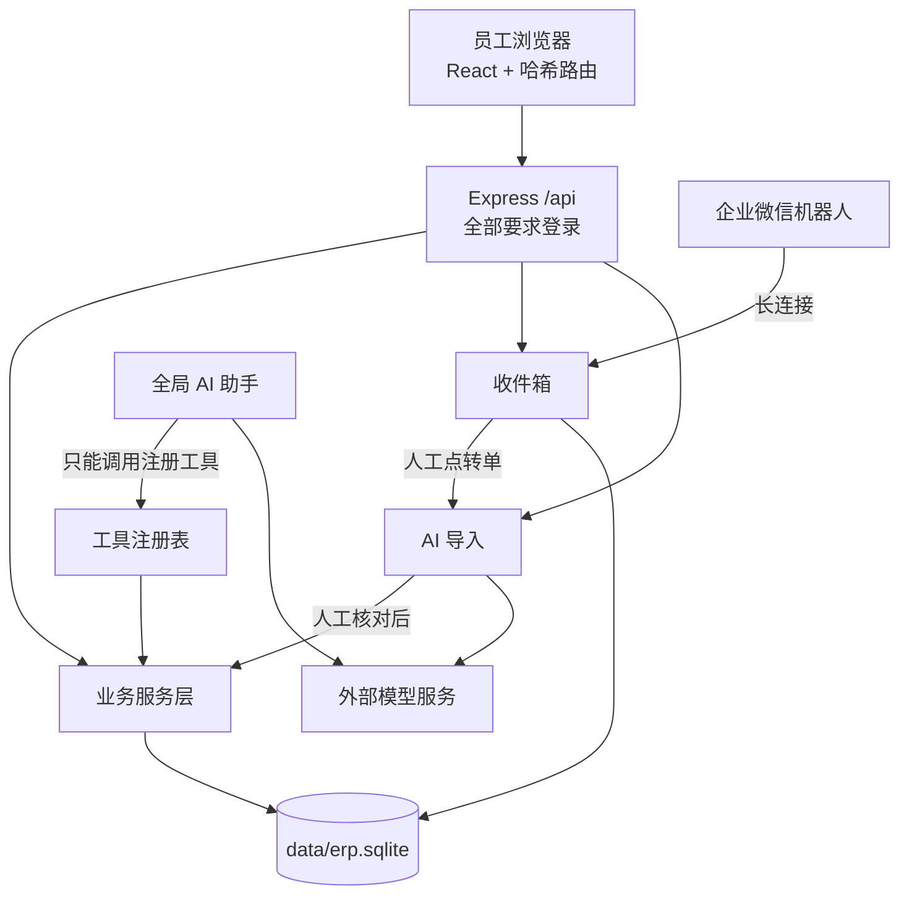
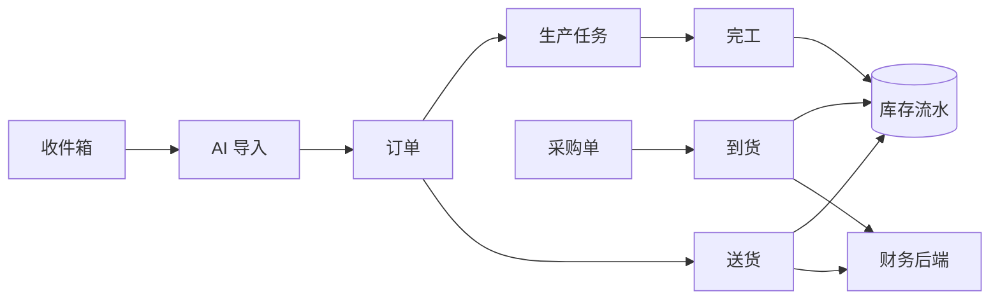

# 架构说明

系统现在是什么样。版本号以代码为准：`shared/version.ts`（软件）、`server/business/metadata.ts` 的 `CATALOG_VERSION`（业务目录）、`server/backup.ts` 的 `supportedDatabaseVersions`（数据库迁移）。

## 总览

**技术栈：** React 19、Vite、Express 5、`node:sqlite`、TypeScript，Node 24。前后端共用 `shared/` 里的类型和校验。

## 代码分层

| 目录 | 负责 |
|---|---|
| `src/` | 页面。`App.tsx` 装配，`src/ui/` 是通用组件，`design.css` 是设计系统 |
| `shared/` | 前后端共用的字段规则、金额计算、导航、能力清单 |
| `server/app.ts`、`index.ts` | HTTP 装配和启动 |
| `server/business/` | 客户、产品、订单、归档、删除、审计、今日页 |
| `server/operations/` | 供应商、采购、库存档案和流水 |
| `server/flow/` | 到货、生产任务、完工、送货、排程 |
| `server/documents/` | 采购单、送货单的 Word/Excel 导出和模板 |
| `server/import/` | AI 导入工作区：原件、草稿、匹配、正式导入 |
| `server/inbox/` | 收件箱和企业微信机器人 |
| `server/marks/` | 产品唛头 |
| `src/finance/` | 财务页面，单独打包，用 `kit.tsx` 的通用表格和表单窗口 |
| `server/finance/` | 财务后端。来源扫描独立于实物流转，正式报表基于记账分录，经营报表另按单据和资金收付取数 |
| `server/assistant/` | 全局助手：调度、工具注册、任务台账、插件、页面控制 |
| `server/ai/` | 模型服务适配、密钥、提示词 |
| `server/speech/` | 可选的本地语音输入 |

## 业务主线

- **订单：** `status` 和发货进度分开。生产中、待发货、已发货由有效单据派生（`FlowService.updateOrders`）。
- **采购：** `businessStatus` 和到货进度分开。到货统一走正式到货事务，`receiptEvents` 负责合并新旧记录，同一批只算一次。
- **库存：** 余额只由 `stock_movements` 派生。数量是千分单位整数。更正靠追加冲销和替代流水。
- **生产和送货：** 单据存 `flow_documents`，关联查询走 `flow_refs` 索引。计划日期不影响实际业务和库存。
- **送货金额：** 确认时把价格、料号、订单号和本批金额写进单据快照，历史单据缺价格不猜。
- **产品唛头：** 只是参考资料，不产生订单、生产或库存。

## AI 导入

1. 上传原件，保存文件和哈希。
2. 用户选类型（客户订单、到货单、唛头）并触发识别。**上传和转单都不会自动发给模型。**
3. 识别结果进草稿，人工核对，匹配客户和产品。
4. 正式提交走 `ImportExecutionService`：完整预览、绑定版本和身份、事务、幂等、审计。

匹配只做保守判断：唯一完全同名的客户可预选；产品和唛头只有明确一致才预选，相似的只作候选。

Responses 协议服务直接传原件；DeepSeek 官方接口不支持文档，走明确说明过的文字提取或扫描 PDF 转图。不做本地 OCR。

## 全局助手

- 只有一套调度：`AssistantManager`、`AssistantToolRegistry`、`AssistantTaskLedger`。
- 模型只能通过 JSON 信封选择注册工具。真实账号权限、插件和工具开关、参数校验都在服务端判断。写入复用业务服务。
- 附件、备注、收件箱、页面文字只算数据，不能授权操作。
- 任务按步持久化，继续时先核验回执，已成功的写入不重放。完成要以真实回执为准，不靠模型声明。
- 额度默认不限，超时 2 小时，由 `ERP_AGENT_*` 环境变量配置（`server/assistant/budget.ts`）。
- 页面控制（`page.*`）操作当前标签页；`browser.*` 操作独立的本机 ERP 窗口。都排除密码和密钥区域。
- 界面：展开时默认停靠右侧（`Ctrl+J`，可切浮动窗口），收起时默认是悬浮纸箱精灵（可切到顶栏入口）。

工具清单见[功能链路表](功能链路表.md)和 `shared/ui-capabilities.ts`。

## 账号和权限

| 级别 | 权限 |
|---|---|
| 管理员 | `super_admin`，业务编辑、正式导入、恢复 |
| 业务人员 | 业务编辑、正式导入 |
| 只读 | 只能查看 |
| 财务 | 财务全部权限和业务编辑 |
| 出纳 | 财务查看和收付款 |

- `/api` 全局要求登录，只有 `/health`、`/auth/*` 例外。写操作还要 CSRF 令牌，并由服务层校验权限。
- 登录状态存内存，重启要重新登录。
- 本机管理员：`super_admin` 且请求确实来自本机、没有代理头，才能用本机数据管理（直接编辑、删除、初始化）。部署到服务器后这部分能力不可用。

## 数据存放

| 位置 | 内容 |
|---|---|
| `data/erp.sqlite` | 全部业务数据、助手聊天、收件箱、唛头。见[数据模型](数据模型.md) |
| `data/security/users.sqlite` | 账号及部署模式的登录会话 |
| `data/ai-imports/` | AI 导入工作区、原件、错误档案 |
| `data/ai-prompts/`、`data/ai-tools/` | 提示词、工具开关 |
| `data/snapshots/` | 删除、初始化或启动迁移前的业务库快照 |
| `backups/` | 完整备份 |
| `%LOCALAPPDATA%\ZhixuERP\ai\settings.sqlite` | 模型服务配置和加密密钥 |
| `%LOCALAPPDATA%\ZhixuERP\wecom\bot.sqlite` | 企业微信机器人凭据 |

密钥用 Windows DPAPI 加密，只在服务端。

部署模式使用两个回环端口。维护端口接收本机直连，代理端口只接受配置的公网 Host 和同机代理提供的单个 `X-ERP-Client-IP`。公网请求在代理端口始终按远程访问处理。详见[部署与运维](部署与运维.md)。

## 不要做的结构性改动

- 不新建第二套业务库、Agent 或工具注册表。
- 不删已有迁移，旧库升级还要用。
- 没有普通 import 的文件不一定是废弃的，先查[项目目录与维护](项目目录与维护.md)的“特别保留”。

截至 0.6.1 的详细设计演进见[旧版架构文档](history/架构说明-至0.6.1.md)。
