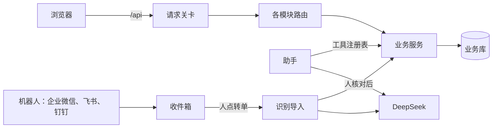
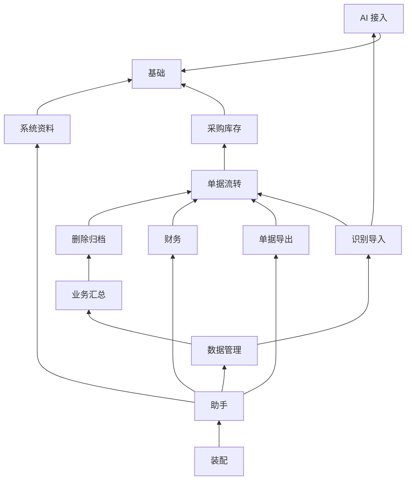

# 架构说明

系统怎么搭的入口：总览、一张订单的数据怎么走、模块、目录、一次请求怎么走。服务端通用做法和各机制在 `docs/架构/` 下各一份，见文末[别的在哪份](#别的在哪份)。硬规则在 `AGENTS.md`；表和字段见[数据模型](数据模型.md)；页面、地址、助手工具的对照见[功能链路表](功能链路表.md)；界面写法见[界面规范](界面规范.md)；部署运维见[部署与运维](部署与运维.md)；没做的见[路线图](路线图.md)。

版本号以代码为准：软件 `shared/core/version.ts`，业务库结构 `server/core/schema/version.ts` 的 `SCHEMA_LATEST`。

## 总览

- **是什么、谁用：** 宁波甬勒包装制品有限公司自用的纸箱厂 ERP。员工按账号级别登录：管理员、业务人员、只读、财务、出纳。正式部署在腾讯云 Ubuntu 服务器，同机 Caddy 做 HTTPS，域名已备案；Windows 也能单机装。
- **怎么跑：** 一个 Node 进程（`server/index.ts`）既回 `/api`，也发构建好的页面 `dist/`，只监听本机回环；部署时另开一个端口给同机 Caddy。员工用浏览器，或安卓 App（`apps/android`）、Windows 客户端（`apps/desktop`）打开同一个网址。
- **技术栈：** 前端 React 19 + Vite（哈希路由），服务端 Express 5 + `node:sqlite`，TypeScript，Node 24；前后端共用 `shared/` 的类型、校验和计算。模型只接 DeepSeek。
- **数据：** 业务数据（客户、产品、订单、采购库存、单据、财务、助手会话、审计）在一个业务库 `erp.sqlite`。账号、出错记录、AI 设置、提示词、助手工具设置、机器人设置、AI 识别工作区各是一个小配置库。原件、备份、删除前快照是文件。各库都按编号的升级步骤升级（[数据库结构版本](架构/数据库和备份.md)）；存在哪、有哪些表见[数据模型](数据模型.md)。
- **做到哪：** 已发布的版本看 Git 标签，没发布的改动看[更新日志](CHANGELOG.md)，待办和已知问题看[路线图](路线图.md)。
- **三个入口进同一套服务：** 页面经请求关卡到各模块路由；助手经工具注册表调同一批业务服务，改数据一律出确认卡片；机器人只收文件进收件箱，人点了才转进识别导入。

## 一张订单的数据怎么走

括号里是负责的模块。

1. **进件和接单：** 客户文件经机器人进收件箱（识别导入）。人点“转订单”复制进 AI 导入工作区（也可直接上传），点识别时原件发给 DeepSeek 填表。人核对后正式导入，一个事务里建客户、产品、订单（`server/import/import-execution.ts`）。也可在订单页手工建。订单存 `orders`、`order_lines`（基础的 `Store`），保存入口在业务汇总（`server/business/service.ts`）。人能选的状态只有待确认、已确认、已取消。
2. **采购和到货：** 采购单（采购库存）合成订货单导出给供应商（单据导出），文件存好后采购单变已订货（也可不导出直接改）。货到了按订货单登记到货（单据流转的 `registerArrival`；AI 识别的送货单先存成待入库）。核对确认（`server/flow/rules/confirm.ts`）时写入库流水 `stock_movements`（原材料只收“张”），采购明细的已到货跟着重算。
3. **生产：** 安排生产任务（`flow_documents` 的 `task`，安排即下达）。登记完工（`production`，可先存成待入库再逐张核对），入库时写成品入库（只收“只”）和领料出库流水。订单的生产中、待发货由有效单据重算。
4. **送货：** “安排送货”出待送货的送货单（`delivery` 的 `draft`）。导出并出库（或不导出直接出库）时写成品出库流水、单据生效，订单变已发货或显示部分发货。确认送达只记日期。库存余额由流水加总，不能为负。
5. **进财务：** 财务只经单据流转的只读窗口 `financeFacts` 读业务。财务页面和助手查财务前先补扫：每张已确认或已撤销的送货、到货、完工单和盘点流水生成一条财务事件 `fin_events`。资料待补（如缺税率）或等发票的送货、到货，先按单据单价挂暂估往来 `fin_obligations`（应收、应付）。缺税率不拦业务，事后在月度台账补。
6. **记账和收款：** 财务人员处理事件、生成凭证（送货确认收入、到货暂估，同时记往来）。登记收款单、付款单（`fin_cash_documents`，保存后确认），核销到送货、到货挂的那笔应收应付（`fin_allocations`，`server/finance/settlements.ts`；地址见[功能链路表](功能链路表.md)“财务”）。再登记发票，月末算成本（加权平均）、结账、出报表。已记账凭证只能红字冲销；业务单据事后被更正、撤销、删除，财务下次补扫按来源指纹发现并标出要人处理的。

## 模块

服务端、共用、前端按同一套模块分目录，五条规则见 `AGENTS.md`“模块”。模块、允许的依赖、模块内的层（`layers`）登记在 `tests/module-map.ts`，改规则时同步改本节。

| 测试 | 拦什么 |
|---|---|
| `tests/module-boundaries.test.ts` | 只往下用、只走 `index.ts`、没有循环、模块内的层 |
| `tests/module-api-owners.test.ts` | 前端只请求能用的模块的地址；地址前缀归属 `apiOwners` |
| `tests/module-table-owners.test.ts` | 表只由主人写，表的主人 `tableOwnerList` |
| `tests/css-modules.test.ts` | 样式只用本模块和能用的模块的类名、本层和下层的 |
| `tests/module-narrow-refs.test.ts` | 只许窄引用的（财务只用 `financeFacts`） |
| `tests/module-test-entries.test.ts` | 测试只经入口引模块 |
| `tests/module-names.test.ts` | 登记用的模块名和模块表一致 |

**模块里的分层：** 下表四个模块内部再分层，同一模块里只能用本层和下层，代码和样式都查。每个文件都要登记进某一层（入口 `index.ts`、`pages.ts` 除外）。下层要用的东西放下层那一份。层名不和模块同名；样式类名的层按写出它的最低一层目录算。其余模块内部不分层，按 `AGENTS.md`“文件怎么分”。

| 模块 | 从下往上 | 说明 |
|---|---|---|
| 前端业务 | 业务公共件（`src/recordkit/`、`src/marks/`、`src/editors/`）← 单据（`src/flow/`）← 采购仓储（`src/operations/`、`src/warehouse/`）← 页面（`src/records/`） | 上层嵌下层的窗口，下层要开上层的页面用页面地址。单据在采购仓储下面（采购、仓储页面要显示单据），和服务端顺序不同 |
| 共用业务（`shared/business/` 按文件） | 采购库存 ← 单据流转 ← 删除归档 ← 业务汇总 | 每层对应一个服务端模块，那四个模块用共用业务也按这个限：经 `shared/business/index.ts` 引的名字按来源文件算层，看不出名字的引用（`import * as`、不带名字的 `import(…)`）直接报。删除归档层放删除的请求和叫法（`deletion-*.ts`）、批量归档接口表 `lifecycle-api.ts`、能删能管的记录种类 `data-management-modules.ts` |
| 服务端采购库存（`server/operations/`） | 账和读（`ledger/`）← 库存品和订货单（`stock/`、`batches/`）← 采购单（`purchases/`）← 服务和路由（根目录） | `ledger/` 放写流水、采购明细和版本号的 `ledger.ts`，三类记录都要用的读取 `repository.ts`，库存品规格，写入共用的权限和版本核对 |
| 服务端单据流转（`server/flow/`） | 单据存取（`documents/`；财务只读窗口 `finance-facts/` 也在这层）← 规则和服务（`rules/`、`stock/`）← 按种类（`arrival/`、`production/`、`delivery/`）← 更正（`correction/`）← 路由和台账（根目录，含仓库台账 `daily.ts`） | `rules/` 放核对、预览、确认、撤销、订单进度、管理员连带和 `FlowService`；按种类的核对 `FlowService` 要用，也放这里。`stock/` 放采购单、库存品、流水、订货单的完整视图、保存入口、成品批次 |

| 模块 | 管什么 | 服务端 | 共用 | 前端 |
|---|---|---|---|---|
| 基础 | 业务库建表和升级、配置库版本、客户产品订单读写（`Store`）、取号、防重复提交、账号和权限、审计、统一报错、归档恢复、流式写出、备份和快照、每日清理、出错记录（`diagnostics/`）；给上层登记用的接口 | `server/core/` | `shared/core/` | `src/ui/`（通用组件、请求、插槽、事件、样式变量） |
| 系统资料 | 给助手和管理员查的只读资料：运行日志、登录记录、读程序代码、使用手册（`GET /api/guide`）；只有助手和装配在用 | `server/system/` | `shared/system/` | `src/system/`（使用说明页） |
| AI 接入 | 发给 DeepSeek 的唯一出口：地址 `https://api.deepseek.com`、模型 `deepseek-flash` 写死在 `shared/ai/deepseek.ts`，界面不能改。对话和识别用 `/chat/completions`（流式、工具调用，思考档位关、低、高、最高），联网 `/v1/tools/search`、`/v1/tools/fetch`，语音 `/v1/tools/asr`、`/v1/tools/tts`，另有文件接口。回来的 JSON 都经 `transport.ts` 的 `readShaped` 按结构核对，不合报“格式不对”。另管密钥设置、提示词库（`createPromptManagers`；默认内容由用它的模块给：识别的在 `server/import/default-prompts/`，助手的在 `server/assistant/default-prompt.ts`） | `server/ai/` | `shared/ai/` | 没有页面，设置页在数据管理 |
| 采购库存 | 供应商、采购单、库存品和流水、订货单的表、写入规则和基本视图（只有自己的数据）；轻量只读 `lookups.ts`（版本号和余额、一笔流水的范围、负库存等）；地址只有 `/suppliers` | `server/operations/` | `shared/business/`（分层见上） | 业务页面合成一个“前端业务”模块，分层见上 |
| 单据流转 | 到货、生产任务、完工、送货、采购退货、排程、成品批次、订单进度派生、管理员改数据的连带；采购单、库存品、流水、订货单的完整视图（`FlowService.views`）和保存入口（`FlowService.stock`）；地址 `/flow`、`/purchases`、`/warehouse`、`/order-batches`；单据轻量只读 `document-lookups.ts` | `server/flow/` | 同上 | 同上 |
| 删除归档 | 删除引擎（`/deletions`）、六类档案的归档恢复和什么时候不能归档（`/<档案>/batch`）、按类型读六类档案（`records.ts`）；没有自己的表，不用业务汇总 | `server/lifecycle/` | 同上 | 同上 |
| 业务汇总 | 客户产品订单的保存入口、订单状态动作、列表筛选（订单筛选在 `shared/business/order-filter.ts`，页面和助手共用）、今日和经营概况、关联记录和修改历史、产品唛头、按模块读记录（`module-records.ts`，数据管理和助手共用） | `server/business/` | 同上 | 同上 |
| 财务 | 财务事件、凭证账簿、往来、资金发票、费用资产工资、成本、结账报表 | `server/finance/` | `shared/finance/` | `src/finance/`（单独打包） |
| 单据导出 | 采购单、订货单、送货单的 Word/Excel，导出记录，模板设置。送货单材质楞型优先取已出库或留下的明细，待送货取产品档案；导出前核对在 `export-checks.ts` | `server/documents/` | `shared/documents/` | `src/documents/`（导出窗、模板设置、文件交付） |
| 识别导入 | AI 导入工作区、订单和到货单识别、正式导入、收件箱和三家机器人 | `server/import/`、`server/inbox/` | `shared/import/` | `src/import/` |
| 数据管理 | 初始化、本机管理员改业务数据、工作区管理；没有自己的表。命令入口 `DataManagementService.execute`；读记录在 `managed-records.ts`（录入结构 `inputSchemas`），保存在 `managed-save.ts`：补丁里录入结构不收的栏目拒收（明细、纸板资料也逐层查），照读出来原样带回的算出值（已发数量、金额）放过；已生效的单据只走说明编辑和更正 | `server/admin/` | `shared/admin/` | `src/admin/`（也放 AI 设置、提示词、消息接入设置页） |
| 助手 | 对话内核、工具注册表和命令目录、确认卡片、长期记忆、看页面、语音 | `server/assistant/` | `shared/assistant/` | `src/assistant/` |
| 装配 | 启动、挂路由、请求关卡、命令行；前端入口、导航、登录、设置总页、插槽装配 | `server/` 根目录 | — | `src/` 根目录、`src/mobile/` |

箭头读作“用”，只画直接一层，顺着能走到的都能用。财务用单据流转只许经只读窗口 `financeFacts`，不调业务服务、不读业务的表；业务不调财务。数据管理 → 识别导入只引类型。

- **共用代码：** 共用-基础、共用-AI、共用-系统资料不用别的；共用-业务、共用-财务用共用-基础；共用-单据、共用-管理用共用-基础和共用-业务；共用-识别用共用-基础和共用-AI；共用-助手用共用-基础、共用-业务、共用-AI。
- **前端（和服务端不同）：** 基础 ← 单据导出 ← 业务 ← 识别、管理、助手；财务、使用说明页只用基础；装配用全部。
  - 单据导出排在业务下面（业务页面嵌它的导出窗），只用共用-基础、共用-单据；助手也直接用它。
  - 前端管理还用共用-AI、共用-识别；前端助手不用共用-识别。

### 低层要用高层的东西

| 做法 | 用在哪 | 例子 |
|---|---|---|
| 调用方传入 | 服务端低层要高层的数据 | 每日清理各项由 `server/index.ts` 传给 `scheduleDailyCleanup`；归档的读状态、打标记、审计由各模块给 `changeArchive`；改已有采购单、库存品时，单据流转先算好单据事实和要连带改单据的函数，传给采购库存的 `savePurchase`、`saveItem`，在同一保存点里调 |
| 登记 | 低层定义接口，高层加载时登记实现，没登记就报错 | 订单进度（`registerOrderRules`）；产品改了成品库存跟着改（`registerProductStockSync`）；删除和初始化规则（`server/core/deletion-rules.ts`）；能归档、能记墓碑的记录种类（`registerRecordKinds`）；配置库默认位置（`registerVersionedSqlite`）。登记用的模块名类型是 `server/core/module-names.ts` 的 `ModuleName` |
| 插槽 | 前端低层页面里放高层模块的东西（`src/ui/slots.tsx` 定义，`src/slots.ts` 装配，没填不显示） | 详情里的财务段（没有 `finance:view` 不渲染也不下载）；到货页的“AI 识别送货单”；保存文件 `saveFile`（安卓 App 里交给 App 存） |
| 服务接口 | 前端读写别的模块的数据（`src/ui/slots.tsx` 定义，各模块 `services.ts` 实现） | 今日页的收件箱和到期应收应付；识别导入里复制识别文件 |
| 事件 | 前端模块之间通知（`src/ui/events.ts` 的 `emit`、`listen`） | 数据变了刷新列表；打开助手 |
| 按需加载 | 整页走模块的 `pages.ts`，汇总在 `src/lazy-pages.ts`；只用一小段的另立入口，登记在 `tests/module-map.ts` 的 `lazyEntries` 写理由；点了才开的窗口在模块里直接 `lazy()`、包 `Suspense` 显示“正在打开…” | 财务段 `src/finance/related-pages.ts`；删除窗、更正到货单窗、客户产品订单编辑窗。这些不许进首屏（[首屏体积上限](架构/检查和测试.md#首屏体积上限)） |

## 目录

| 位置 | 放什么 |
|---|---|
| `server/` 根目录 | `index.ts` 正式启动（按真实数据目录，不要运行或加载；建好各模块交给 `app.ts`）、`app.ts` 挂路由和发页面（测试和预览实例从这里起）、`http-guards.ts` 请求关卡、`http-errors.ts` 出错回答、`backup-extras.ts` 备份里另存的本机配置清单、`maintenance.ts` 维护命令行（`backup`、`restore`、`reset-password`、`revert-config-upgrades`）、`local-service.ts`、`stop.ts` |
| `server/<模块>/`、`shared/<模块>/`、`src/<模块>/` | 各模块代码，对外只走 `index.ts`（整页走 `pages.ts`）；新目录先在 `tests/module-map.ts` 登记 |
| `src/` 根目录 | 入口 `main.tsx`（全部样式在这里引入、定先后）、`App.tsx`、外壳 hook `app-shell.ts`（含设置页签谁看得到 `settingsTabsOf`）、导航、插槽装配 `slots.ts`、登录页和账号菜单、安卓 App 通道 `app-bridge.ts` |
| `public/` | `theme-init.js`（首屏主题）、`favicon.svg` |
| `scripts/` | 启停、构建 `build.mjs`、测试和体检（`run-tests.mjs`、`check.mjs`、`check-apps.mjs`）、发布和补丁（`package-release.mjs`、程序文件清单 `release-files.mjs`、`patch-server.mjs`）、`schema-dump.ts`、`linux/`（服务器脚本、systemd、Caddy 示例；补丁在服务器上由 `apply-patch.mjs` 执行，回滚时先换回配置库再看业务库；它引的同目录文件要列进 `patch-server.mjs` 的 `applyScripts`）、`ui-check/`（界面实测、预览实例 `preview.mjs`、样式比对、识别前后对比） |
| `tests/` | 测试和准备代码，见[检查和测试](架构/检查和测试.md) |
| 根目录 | 检查配置 `eslint.config.js`、`stylelint.config.mjs`、`knip.json`；给 AI 的规则和环境 `AGENTS.md`、`CLAUDE.md`、`.claude/`（三家智能体共用，`.agents/` 和 `.codex/` 只放指路配置）；Windows 启停 `启动系统.cmd`、`停止系统.cmd` |
| `docs/` | 文档（清单和读的顺序见 [docs/README](README.md)）；`brand/` 商标原图（改商标时 `src/ui/BrandLogo.tsx`、`public/favicon.svg` 一起改） |
| `apps/` | 两个应用外壳，各自成一体、不引用项目其余代码：`apps/android/`（原生 Java WebView）、`apps/desktop/`（Rust + Tauri 2）；和网页的接点见[外壳和网页](架构/外壳和网页.md) |

## 一次请求怎么走

1. **前端：** 一律经 `src/ui/http.ts` 的 `request` 发（`call()`、带 `X-ERP-AI-Token` 的 `tokenRequest`、上传 `uploadFile` 都经过它）。请求收在各模块的 `*-api.ts`，一个写地址只由一个函数发；财务读用 `useFinRead`、`finRead`，写用 `call<FinanceWrites>()`、经 `finWritten` 刷新。返回 `unknown` 的由调用方按结构认。没登录时说“请先登录账号。”、不发；只有 401 回登录页；断网说“连不上服务器，请检查网络后再试。”；服务器回正忙（429 `busy`）按 `Retry-After` 停一下自动再发一次；失败的请求和页面报错上报出错记录；事件流由 `readEventStream` 读。
2. **关卡（`server/http-guards.ts`，按顺序）：** 记失败请求 → 安全响应头 → 只许本机或登记的代理域名、核对来源、写请求只收 JSON（几个上传入口除外）→ 纯财务账号只能用财务接口（`shared/core/account-scope.ts`）→ 除 `/api/health`、`/api/auth/*` 外要登录 → 写接口要页面凭证（`/api/auth/*`、`/api/ai/*` 用各自的凭证）。
3. **路由 → 服务：** 路由只取参数；权限、版本校验、事务、防重复、审计在服务里（`AGENTS.md`“写入”）。接口表、读库、单据状态和种类的写法、防重复提交、事务保存点、先预览再确认、审计各只有一种做法，见[服务端通用做法](架构/服务端写法.md)。
4. **出错（`server/http-errors.ts`）：** 校验没过回 400，经 `shared/core/user-errors.ts` 的 `userError` 写成按界面叫法的中文整句（按地址认记录种类，如采购单的日期叫“采购日期”；页面显示时再过一遍）。`AppError` 原样带状态码、`code`、`details`。被数据库约束拦下的回“数据没有保存：有内容不符合数据规则，请联系维护人员。”，英文原文进带 `[数据规则]` 的日志。业务代码该在写库前拦住说清原因，走到约束就是程序问题。
5. **边算边推：** 助手对话、识别、朗读、语音识别只用 `server/core/stream.ts`：`openEventStream`（心跳每 10 秒一行注释；同一阶段的进度和字最多 250 毫秒推一条，换阶段和最后一条不丢）、`pipeBytes`、`watchDisconnect`。

## 别的在哪份

各机制在 `docs/架构/` 下各一份，每份开头说清讲什么。别处按小节名指过来的，照这张表找。

| 小节 | 在哪 |
|---|---|
| **接口表**、**读库**、**单据状态、种类的写法**、**防重复提交**、**事务保存点**、**先预览再确认**、**审计** | [架构/服务端写法](架构/服务端写法.md) |
| **检查和测试**（**测试怎么跑**、**测试怎么写**、**测试的准备代码**、**代码检查**、**防两套和文档的检查**、**两边写的清单对得上的检查**、**检查一览**、**首屏体积上限**、**两个外壳的检查**、**几组手动跑的比对和验证脚本**） | [架构/检查和测试](架构/检查和测试.md) |
| **库存流水和余额** | [架构/业务主线](架构/业务主线.md#库存流水和余额) |
| **单据流转和订单进度**（**单据**、**归档**、**订单进度**、**采购已到货**、**登记到货**、**改已生效的单据**、**送货**、**完工** 等） | [架构/业务主线](架构/业务主线.md#单据流转和订单进度) |
| **删除和初始化** | [架构/业务主线](架构/业务主线.md#删除和初始化) |
| **财务事件和凭证** | [架构/财务](架构/财务.md) |
| **识别导入** | [架构/识别导入](架构/识别导入.md) |
| **助手**（**六条界限**、**长期记忆**、**命令目录** 等） | [架构/助手](架构/助手.md) |
| **数据库结构版本**（业务库、配置库、**改结构时一起改**、备份恢复、编号、每日清理） | [架构/数据库和备份](架构/数据库和备份.md) |
| **账号和权限** | [架构/账号和权限](架构/账号和权限.md) |
| **前端约定** | [架构/前端约定](架构/前端约定.md) |
| **网页怎么认出两个外壳**、**备案号**、**安卓 App 通道** | [架构/外壳和网页](架构/外壳和网页.md) |
