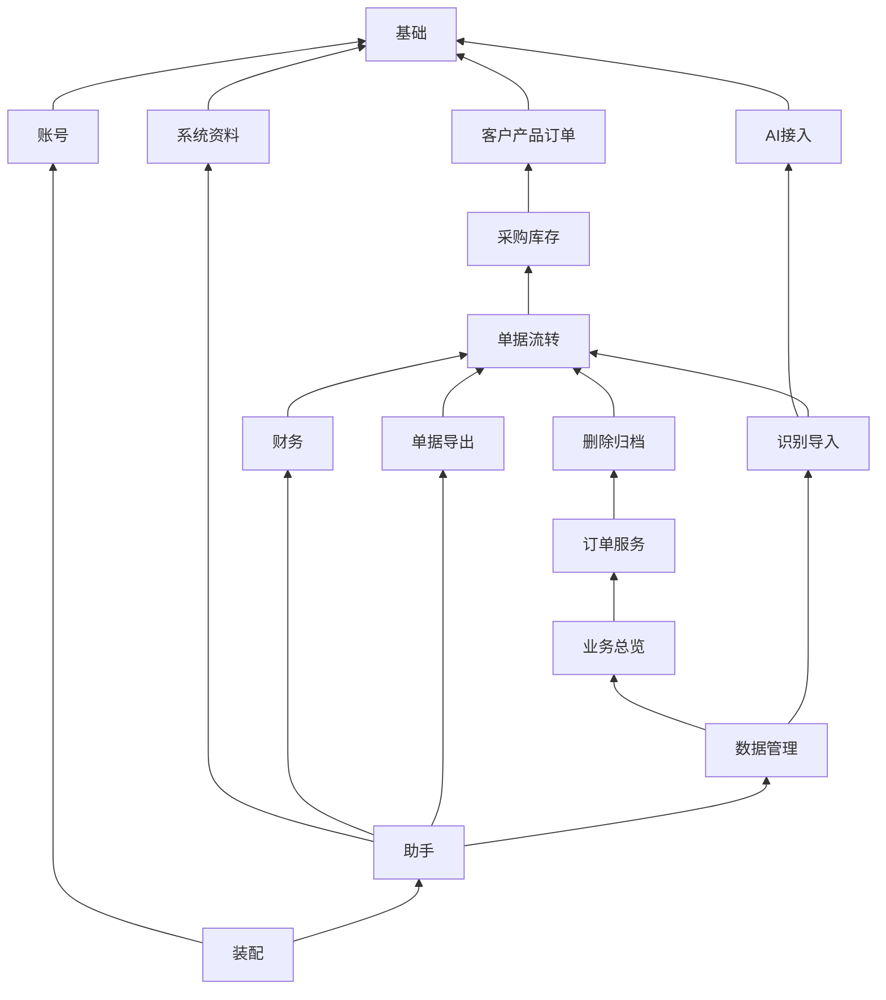
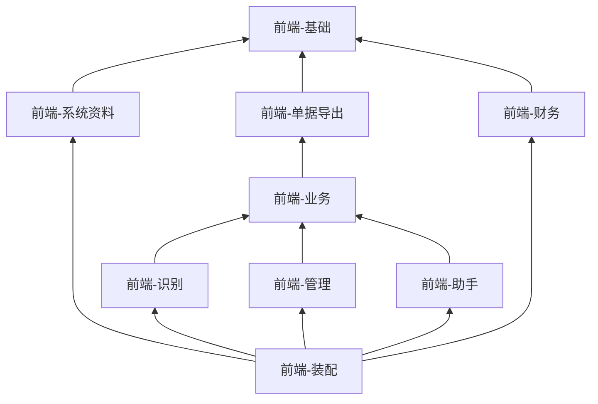

# 模块表

什么时候读：加文件、目录、跨模块引用时，查每个模块管什么、目录在哪、能用哪些模块、模块里怎么分层，以及守模块规则的检查。

由 `npm run docs:gen` 生成，不手改：全部来自 `tests/checks/module-map.ts`（模块的 `what`、`layerNote` 和 `moduleChecks` 是写给这份的说明）。改了那份就跑 `npm run docs:gen`；`tests/checks/docs-generated.test.ts` 核对这份是不是最新。五条规则和怎么用这张表，相关的见 `docs/架构/模块规则.md`。

## 服务端

| 模块 | 目录 | 管什么 | 能用 |
|---|---|---|---|
| 基础 | `server/core/` | 业务库建表和升级、配置库版本、业务库连接和归档标记（`Store`）、取号、防重复提交、请求身份接口和权限规则、审计、统一报错、归档恢复、流式写出、备份和快照、每日清理、出错记录（`diagnostics/`）；给上层登记用的接口 | 共用-基础 |
| 账号 | `server/accounts/` | 登录、会话、账号管理、账号申请和登录记录；地址 `/api/auth`。账号规则和接口表在 `shared/core/`；登录页和账号菜单在前端-装配，账号管理页在前端-管理 | 基础、共用-基础 |
| AI接入 | `server/ai/` | 发给 DeepSeek 的唯一出口：地址 `https://api.deepseek.com`、模型 `deepseek-flash` 写死在 `shared/ai/deepseek.ts`，界面不能改。对话和识别用 `/chat/completions`（流式、工具调用，思考档位关、低、高、最高），联网 `/v1/tools/search`、`/v1/tools/fetch`，语音 `/v1/tools/asr`、`/v1/tools/tts`，另有文件接口。回来的 JSON 都经 `transport.ts` 的 `readShaped` 按结构核对，不合报“格式不对”。另管密钥设置、提示词库（`createPromptManagers`；默认内容由用它的模块给：识别的在 `server/import/default-prompts/`，助手的在 `server/assistant/default-prompt.ts`）。没有页面，设置页在前端-管理 | 基础、共用-基础、共用-AI |
| 系统资料 | `server/system/` | 给助手和管理员查的只读资料：运行日志、读程序代码、使用手册（`GET /api/guide`）；只有助手和装配在用（出错记录是请求关卡和页面上报写的，留在基础） | 基础、共用-基础、共用-系统资料 |
| 客户产品订单 | `server/sales/` | 客户和收货厂区、产品和普通订单读写（`sales(store)`）、查重、唛头资料；地址 `/marks`、`/products/:id/marks` | 基础、共用-基础、共用-业务 |
| 采购库存 | `server/operations/` | 供应商、采购单、库存品和流水、订货单的表、写入规则、基本视图和订料进度（只有自己的数据）；轻量只读 `lookups.ts`（版本号和余额、一笔流水的范围、负库存等）；地址只有 `/suppliers` | 基础、客户产品订单、共用-基础、共用-业务 |
| 单据流转 | `server/flow/` | 到货、生产任务、完工、送货、采购退货、排程、成品批次、订单状态和已发数量的派生、管理员改数据的连带；采购单、库存品、流水、订货单的完整视图（`FlowService.views`）和保存入口（`FlowService.stock`）；地址 `/flow`、`/purchases`、`/warehouse`、`/order-batches`；单据轻量只读 `document-lookups.ts` | 基础、客户产品订单、采购库存、共用-基础、共用-业务 |
| 删除归档 | `server/lifecycle/` | 删除引擎（`/deletions`）、六类档案的归档恢复和什么时候不能归档（`/<档案>/batch`）、按类型读六类档案（`records.ts`）；没有自己的表 | 基础、客户产品订单、采购库存、单据流转、共用-基础、共用-业务 |
| 订单服务 | `server/orders/` | 客户、产品、订单的保存入口和列表筛选，厂区移除与送货单解除引用、带进度的订单视图、订单状态动作和改单连带协调；地址 `/customers`、`/products`、`/orders` | 基础、客户产品订单、采购库存、单据流转、删除归档、共用-基础、共用-业务 |
| 业务总览 | `server/overview/` | 今日和经营概况、关联记录和修改历史、按模块读记录（`module-records.ts`，数据管理和助手共用） | 基础、客户产品订单、采购库存、单据流转、删除归档、订单服务、共用-基础、共用-业务 |
| 财务 | `server/finance/` | 财务事件、凭证账簿、往来、资金发票、费用资产工资、成本、结账报表。用单据流转只许经只读窗口 `financeFacts`（`module-narrow-refs.test.ts` 查），不调业务服务、不读业务的表；业务不调财务 | 基础、单据流转、共用-基础、共用-业务、共用-财务 |
| 单据导出 | `server/documents/` | 采购单、订货单、送货单的 Word/Excel，导出记录，模板设置。送货单材质楞型优先取已出库或留下的明细，待送货取产品档案；导出前核对在 `export-checks.ts` | 基础、客户产品订单、采购库存、单据流转、共用-基础、共用-业务、共用-单据 |
| 识别导入 | `server/import/`、`server/inbox/` | AI 导入工作区、订单和到货单识别、正式导入、收件箱和三家机器人 | 基础、客户产品订单、AI接入、单据流转、共用-基础、共用-AI、共用-识别 |
| 数据管理 | `server/admin/` | 初始化、本机管理员改业务数据、工作区管理；没有自己的表。命令入口 `DataManagementService.execute`；读记录在 `managed-records.ts`（录入结构 `inputSchemas`），保存在 `managed-save.ts`：补丁里录入结构不收的栏目拒收（明细、纸板资料也逐层查），照读出来原样带回的算出值（已发数量、金额）放过；已生效的单据只走说明编辑和更正。用识别导入只引类型：识别导入的管理对象由装配传进来 | 基础、采购库存、单据流转、删除归档、订单服务、业务总览、识别导入、共用-基础、共用-业务、共用-管理 |
| 助手 | `server/assistant/` | 对话内核、工具注册表和命令目录、确认卡片、长期记忆、看页面、语音 | 基础、客户产品订单、AI接入、系统资料、采购库存、单据流转、删除归档、订单服务、业务总览、财务、单据导出、识别导入、数据管理、全部共用 |
| 装配 | `server/` | 启动、挂路由、请求关卡、命令行入口，可以引用全部；只算服务端根目录的文件，新建的子目录要登记进别的模块 | 全部 |

箭头读作“用”，只画直接一层，顺着能走到的都能用。

## 共用

| 模块 | 目录 | 管什么 | 能用 |
|---|---|---|---|
| 共用-基础 | `shared/core/` | 前后端共用的基础代码，和服务端同一套分法；账号规则和接口表、全站页面地址册子 `shared/core/pages.ts` 也在这里 | 不用别的模块 |
| 共用-业务 | `shared/business/` | 业务主线（客户产品订单到业务总览）的共用代码 | 共用-基础 |
| 共用-财务 | `shared/finance/` | 财务的共用代码 | 共用-基础 |
| 共用-单据 | `shared/documents/` | 单据导出的共用代码 | 共用-基础、共用-业务 |
| 共用-AI | `shared/ai/` | AI 接入的共用代码 | 不用别的模块 |
| 共用-系统资料 | `shared/system/` | 系统资料的共用代码 | 不用别的模块 |
| 共用-识别 | `shared/import/` | 识别导入的共用代码 | 共用-基础、共用-AI |
| 共用-管理 | `shared/admin/` | 数据管理的共用代码 | 共用-基础、共用-业务 |
| 共用-助手 | `shared/assistant/` | 助手的共用代码 | 共用-基础、共用-业务、共用-AI |

## 前端

前端模块之间的用法和服务端不同，见下图（只画前端模块）。

| 模块 | 目录 | 管什么 | 能用 |
|---|---|---|---|
| 前端-基础 | `src/ui/` | 通用组件、请求、插槽、事件、样式变量；可请求账号接口，用 `/auth/state` 读取登录状态和更新页面凭证 | 共用-基础 |
| 前端-系统资料 | `src/system/` | 使用说明页 | 前端-基础、共用-基础、共用-系统资料 |
| 前端-单据导出 | `src/documents/` | 单据导出的前端：导出窗、模板设置、文件交付。排在业务下面（业务页面嵌它的导出窗），业务页面和助手经它的 `index.ts`、`pages.ts` 用；能用的共用代码不超过服务端单据导出 | 前端-基础、共用-基础、共用-单据 |
| 前端-业务 | `src/records/`、`src/recordkit/`、`src/flow/`、`src/warehouse/`、`src/operations/`、`src/editors/`、`src/marks/` | 业务主线（客户产品订单到业务总览）的页面合成的一个模块 | 前端-基础、前端-单据导出、共用-基础、共用-业务、共用-单据 |
| 前端-财务 | `src/finance/` | 财务页面（单独打包） | 前端-基础、共用-基础、共用-财务 |
| 前端-识别 | `src/import/` | 识别导入的页面 | 前端-基础、前端-业务、共用-基础、共用-业务、共用-AI、共用-识别 |
| 前端-管理 | `src/admin/` | 数据管理页面，也放账号管理页、AI 接入的模型和提示词设置页、识别导入的消息接入设置页，所以还能用共用-AI、共用-识别；可请求账号接口 | 前端-基础、前端-业务、共用-基础、共用-业务、共用-管理、共用-AI、共用-识别 |
| 前端-助手 | `src/assistant/` | 助手的前端，直接用前端-单据导出；可请求账号接口 | 前端-基础、前端-业务、前端-单据导出、共用-基础、共用-业务、共用-AI、共用-助手 |
| 前端-装配 | `src/`、`src/mobile/` | `src/` 根目录和手机导航：入口、导航、登录、账号菜单、设置总页、插槽装配，把各模块的页面装起来 | 全部前端、全部共用 |

箭头读作“用”，只画直接一层，顺着能走到的都能用。

## 模块里的分层

| 模块 | 从下往上 | 说明 |
|---|---|---|
| 基础 | 请求和报错（`server/core/http/`） ← 文件校验（`server/core/files/`） ← SQLite 基础（`server/core/storage/sqlite/`） ← 业务库结构（`server/core/schema/`） ← 记录种类登记（`server/core/records/kinds/`） ← 业务库存储（`server/core/storage/`） ← 记录维护（`server/core/records/`） ← 备份和配置库（`server/core/backup/`） ← 出错记录（`server/core/diagnostics/`） | 建表、升级和备份共用 SQLite 的只读连接和一致副本。`Store` 使用下层的记录种类登记，归档、审计和删除规则使用 `Store`。其他模块引 `server/core/index.ts` |
| 采购库存 | 账和读（`server/operations/ledger/`） ← 库存品和订货单（`server/operations/stock/`、`server/operations/batches/`） ← 采购单（`server/operations/purchases/`） ← 服务和路由（`server/operations/router.ts`、`server/operations/deletion.ts`、`server/operations/service.ts`） | `ledger/` 放写流水、采购明细和版本号的 `ledger.ts`，三类记录都要用的读取 `repository.ts`，库存品规格，写入共用的权限和版本核对；根目录放服务、路由和删除登记 |
| 单据流转 | 单据存取（`server/flow/documents/`、`server/flow/finance-facts/`） ← 规则和服务（`server/flow/rules/`、`server/flow/stock/`） ← 按种类（`server/flow/arrival/`、`server/flow/production/`、`server/flow/delivery/`） ← 更正（`server/flow/correction/`） ← 路由和台账（`server/flow/daily.ts`、`server/flow/deletion.ts`、`server/flow/router.ts`、`server/flow/stock-router.ts`） | `documents/` 放单据的存取、读、关联，财务只读窗口 `finance-facts/` 也在这层。`rules/` 放核对、预览、确认、撤销、订单进度、管理员连带和 `FlowService`；按种类的核对 `FlowService` 要用，也放这里。`stock/` 放采购单、库存品、流水、订货单的完整视图、保存入口、成品批次。`correction/` 放三种更正和编辑说明。根目录放路由、删除登记和跨种类的仓库台账 `daily.ts` |
| 共用-业务 | 客户产品订单（`shared/business/sales/`） ← 采购库存（`shared/business/operations/`） ← 单据流转（`shared/business/flow/`） ← 删除归档（`shared/business/lifecycle/`） ← 订单服务（`shared/business/orders/`） ← 业务总览（`shared/business/overview/`） | 和服务端业务主线的层对应：文件所在的子目录决定它的层。每层对应一个服务端模块，对应模块只能用同层和下层的文件。经 `shared/business/index.ts` 引的名字按来源文件算层，看不出名字的引用（`import * as`、不带名字的 `import(…)`）直接报。删除归档层放删除的请求和叫法（`deletion-*.ts`）、批量归档接口表 `lifecycle-api.ts`、能删能管的记录种类 `data-management-modules.ts` |
| 前端-业务 | 业务公共件（`src/recordkit/`、`src/marks/`、`src/editors/`） ← 单据（`src/flow/`） ← 采购仓储（`src/operations/`、`src/warehouse/`） ← 页面（`src/records/`） | 按界面角色分层，只往下用：上层嵌下层的窗口，下层要打开上层的页面用页面地址，不引上层的代码。单据在采购仓储下面（采购、仓储页面要显示到货单、送货单，单据窗口用不着采购窗口），和服务端业务主线的顺序不同 |

## 按需加载的入口

各模块的 `pages.ts` 之外另立的按需加载入口：

| 入口 | 为什么 |
|---|---|
| `src/finance/related-pages.ts` | 订单、送货、到货详情里的财务段：业务页面用，走 pages.ts 会把整套财务页面一起下载；在 pages.ts 里给整套页面再套一层 lazy 会让页面变成两层按需加载、入口名不对应实际组件，新开一个顶层目录放一个组件又要把财务模块拆到两个目录，都比登记一个入口更绕 |

## 守模块规则的检查

| 检查 | 拦什么 |
|---|---|
| `tests/checks/module-boundaries.test.ts` | 只往下用、只走 `index.ts`、没有循环、模块内的层 |
| `tests/checks/module-api-owners.test.ts` | 前端只请求能用的模块的地址；地址前缀归属 `apiOwners` |
| `tests/checks/module-table-owners.test.ts` | 表只由主人写，表的主人 `tableOwnerList` |
| `tests/checks/css-modules.test.ts` | 样式只用本模块和能用的模块的类名、本层和下层的 |
| `tests/checks/module-narrow-refs.test.ts` | 财务经 `financeFacts` 读业务；订单服务调用 `updateProduct`，同一保存点同步成品库存 |
| `tests/checks/module-test-entries.test.ts` | 测试只经入口引模块 |
| `tests/checks/module-names.test.ts` | 登记用的模块名和模块表一致 |
